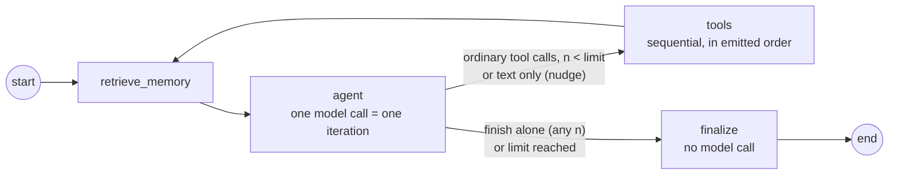
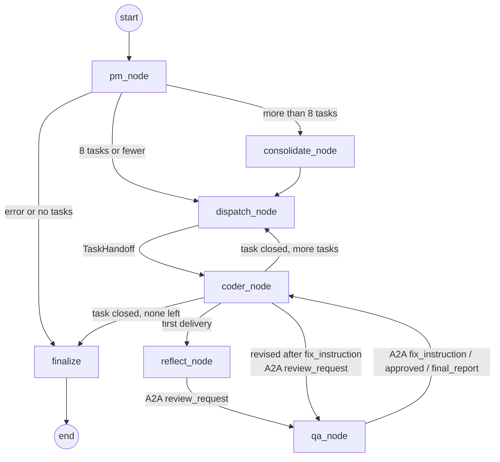

# Multi-Agent Dev Team: PM → Coder ↔ QA (v3)

An autonomous **LangGraph** Coder agent that takes a coding task in plain language, then plans, writes, runs and verifies Python code with **Claude Sonnet**. It works in a bounded ReAct loop (at most 10 model calls), with two memory layers (a sliding window plus Chroma) and three confined tools. Every run ends in a **Pydantic-validated result** whose code is read back from disk and whose result comes from a real execution. It is Module 1 of a five-module capstone: a PM → Coder ↔ QA software team. Modules 2 and 3 add the PM and QA agents on top, with the Coder and QA talking over A2A (see [v3.0](#v30-pm--coder--qa) and [Why A2A](#why-a2a)).


## Quickstart

You need Python 3.12+ and [uv](https://docs.astral.sh/uv/). The default model needs an Anthropic API key (see [other providers](docs/usage.md#other-providers)).

**With 1Password** (the key is resolved at runtime from `.env.op`, never written to disk):

```bash
make setup
op run --env-file=.env.op -- make demo
```

**With a plain `.env`:**

```bash
cp .env.example .env        # then set ANTHROPIC_API_KEY
make setup
make demo
```

**With pip instead of uv:**

```bash
python3.12 -m venv .venv && . .venv/bin/activate
pip install -r requirements.txt && pip install -e . --no-deps
coder --demo --reset-memory
```

**With Docker:**

```bash
ANTHROPIC_API_KEY=... docker compose up web               # http://127.0.0.1:8000
ANTHROPIC_API_KEY=... docker compose run --rm coder "task"
```

The container runs as an unprivileged user (uid 1000). On Linux, build with `UID=$(id -u) GID=$(id -g) docker compose build` so files in the mounted `workspace/` stay owned by you.

## CLI

```bash
uv run coder "Write fizzbuzz.py with pytest tests and run them"
uv run coder --json "…"                 # CoderResult JSON on stdout
uv run coder --max-iterations 5 --timeout 5 "…"
uv run coder --reset-memory             # clear window, Chroma and workspace
```

The terminal shows each step live, prefixed `[n/10]`: the memory retrieved, the model's thought, the plan, each action and each observation. It ends with a result panel. Exit codes: 0 success, 1 failed / iteration limit / error, 2 usage error or busy workspace. All flags are in [docs/usage.md](docs/usage.md).

## Web UI

```bash
uv run coder-web      # http://127.0.0.1:8000
```

A read-only "mini-IDE". It shows the workspace file tree, a code viewer that follows the files the agent writes, a terminal strip with the latest run output, a live agent timeline, and the final result card. It runs the same `CoderAgent` code path as the CLI, streamed over server-sent events.

## Architecture



```
agents/         coder_agent.py (CoderAgent), config, model, prompts, result (CoderResult), events
                pm_agent.py (PMAgent, v2)
                qa_agent.py (QAAgent, v3): writes pytest suites from the criteria, runs them in a sandboxed
                subprocess, parses failures into fix instructions, computes approval in code
tools/          workspace confinement + lock, read_file / write_file, exec_python + _runner, specs, dispatch
memory/         sliding window, Chroma semantic store, context formatting
orchestration/  graph, routing, state, verify, finalize (v1 inner graph)
                team_graph, project_state, handoff, consolidation, team_runner (v2 outer graph)
                a2a (v3 message protocol and broker), review (QA and reflection models)
app/            cli.py (coder), web.py (coder-web), team_cli.py (team), api_check.py, render.py
web/            static mini-IDE (HTML/JS/CSS, no build step)
tests/          unit tests (scripted fake model) + tests/live (real model)
docs/           architecture.md, usage.md, evidence/
```

Details are in [docs/architecture.md](docs/architecture.md).

## Implementation decisions

- **A hand-built LangGraph graph, not `create_react_agent`.** Memory retrieval before every call, the iteration counter, sequential tool execution and a no-LLM finaliser are each a few explicit lines that tests can drive with a scripted fake model.
- **One iteration = one model call; `finish` is a tool.** The agent ends by calling `finish(explanation, plan, entry_point)`. `finalize` never calls the model, so there is no hidden 11th call. Tool calls requested on the 10th call are not executed, because their results could never be seen.
- **Claude Sonnet through `init_chat_model`.** `CODER_MODEL=anthropic:claude-sonnet-5-5` by default. `openai:gpt-4o` or `ollama:<model>` work by changing one variable.
- **Chroma with its default local embedding.** No second API key; Anthropic has no embeddings endpoint. After each run the agent stores what it did (task, outcome, files, plan, summary, defined functions). Retrieval keeps the top 3 within a cosine-distance threshold.
- **Verification from execution records, not hashes alone.** A small runner inside the subprocess records which workspace files each run actually imported, with their hashes at load time. A file is verified only if a successful run after its last write loaded it in its current form. The Pydantic validator refuses `success` without that.
- **One shared workspace with a cross-process lock.** Follow-up tasks build on earlier files. `filelock` makes a second concurrent run fail fast with "workspace busy" instead of corrupting the first.
- **Process-group cleanup.** `exec_python` starts each run in a new session and kills the whole group when the run ends (timeout or not), so a script that spawns children can't outlive it. Workspace modules always compile from current source, never from a cached `.pyc`. Output is drained by threads into bounded buffers, and stdin is `/dev/null`.

## Rubric evidence

| Criterion | Where in code | How to observe |
|---|---|---|
| **C1.1** Reproducible project | Required tree (`agents/ tools/ orchestration/ tests/ docs/`), `.env.example`, `Dockerfile`, `docker-compose.yml`, `requirements.txt`, `pyproject.toml` + `uv.lock` | `make setup && uv run coder --help` |
| **C1.2** Memory, two layers | `memory/window.py`, `memory/semantic.py`; `retrieve_memory` in `orchestration/graph.py` runs before every `agent` call and puts the result in the system message | `make demo`: the second task's `memory:` lines show the first run retrieved. Tests: `tests/test_graph.py::test_memory_retrieved_before_every_call`, `tests/live/test_smoke.py::test_memory_follow_up`. Transcript: [docs/evidence/cli-transcript.txt](docs/evidence/cli-transcript.txt) |
| **C1.3** Real tools, subprocess, timeout | `tools/file_tools.py`, `tools/exec_python.py`, `tools/_runner.py` (no `eval`/`exec`; enforced by `test_no_eval_in_tools`) | `uv run coder --timeout 2 "Write loop.py containing while True: pass and run it"` gives an observation with `timed_out=True (process tree killed)`. Tests: `tests/test_exec_python.py` (infinite loop, spawned child, output flood). Transcript: [docs/evidence/timeout-probe.txt](docs/evidence/timeout-probe.txt) |
| **C1.4** Bounded ReAct (≤ 10) | `orchestration/routing.py`, `orchestration/graph.py`, cap in `agents/config.py` | `uv run coder --max-iterations 1 "Write fizzbuzz.py … with pytest tests, and run them"` ends with status `iteration_limit` after 1 model call; the tools requested on that last call are not executed. `--max-iterations 11` is rejected (exit 2). Claude batches aggressively, so a limit of 2–3 often isn't reached on small tasks; the unit tests force every limit, including the default 10. Tests: `tests/test_graph.py::test_iteration_limit_forced`, `::test_default_limit_is_ten`. Transcript: [docs/evidence/limit-probe.txt](docs/evidence/limit-probe.txt) |
| **C1.5** Validated output | `agents/result.py` (`CoderResult`, success-consistency validator), `orchestration/verify.py`, `orchestration/finalize.py` | `uv run coder --json "…"`. Example: [docs/evidence/coder-result.json](docs/evidence/coder-result.json). Tests: `tests/test_result.py`, `tests/test_verify.py` (the three regression cases) |
| **C1.6** Verified | `tests/live/test_smoke.py` makes a real model call and asserts every field, that code equals the file on disk, and that `verified` is true | `op run --env-file=.env.op -- make verify` (`REQUIRE_LIVE=1`, so a skip fails). Output: [docs/evidence/verify-output.txt](docs/evidence/verify-output.txt) |

## Known limitations

- **The subprocess is not a security sandbox.** Paths and execution targets are confined to `./workspace/`, but code that `exec_python` runs is a normal host process with full filesystem and network access. Container isolation is the Module 4 work. Run the agent only on tasks you'd run yourself.
- **One run per workspace at a time.** A second concurrent run is refused, not queued.
- **The web UI is local and read-only.** There is no authentication. It binds to 127.0.0.1 by default and refuses foreign `Host` headers (`CODER_WEB_ALLOWED_HOSTS`).
- **The memory threshold (cosine distance 0.65) is tuned for the default embedding model.** Other embedding models may need `MEMORY_MAX_DISTANCE`.

## v3.0: PM → Coder ↔ QA

Module 3 completes the three-agent team. One LangGraph graph (`orchestration/team_graph.py`) takes a free-text requirement and runs three agents over a shared `ProjectState`:

- **PM** (`agents/pm_agent.py`) turns the requirement into a spec with acceptance criteria and a task list.
- **Coder** (`agents/coder_agent.py`) builds each task, critiques its own code once, and revises it.
- **QA** (`agents/qa_agent.py`) writes pytest tests from the task's acceptance criteria, runs them in a subprocess with a timeout, parses the failures into structured fix instructions, and decides approval in code from the test results, never from a model's opinion.

Per task, the loop is: `dispatch_node` hands the task over, `coder_node` delivers, `reflect_node` runs the Coder's self-critique and a revision, then `qa_node` tests the revised code. QA replies `fix_instruction` and the Coder revises and resubmits, or QA replies `approved` or `final_report` and the task closes. A round is one QA test run, and the loop is capped by `QA_MAX_ITERATIONS` (default and maximum 5). The v1 `coder` and `coder-web` commands are unchanged.



The same flow as text:

```
requirement
    │
    ▼
 pm_node ──route_after_pm──┬── error or no tasks ───────────────────────────────► finalize ──► END
                           ├── > 8 tasks ──► consolidate_node ──┐                    ▲
                           └── ≤ 8 tasks ───────────────────────┤                    │
                                                                ▼                    │
              ┌─────────────────────────────────────────► dispatch_node              │
              │                                                 │ TaskHandoff        │
              │                                                 ▼                    │
              │                                            coder_node (deliver)      │
              │                                                 │                    │
              │                                                 ▼                    │
              │                                            reflect_node              │
              │                                         critique, then revise        │
              │                                                 │ A2A review_request │
              │                                                 ▼                    │
              │                                  ┌───────► qa_node                   │
              │                                  │  tests, run, report               │
              │                                  │             │                     │
              │                  A2A review_request            │ A2A reply           │
              │                  (next round)    │             ▼                     │
              │                                  └──── coder_node ◄── fix_instruction
              │                                        (revise)                      │
              │                                                                      │
              │                  approved or final_report: coder_node closes the task│
              │                                                 │                    │
              │                                        route_after_coder             │
              └────────────── more tasks ◄──────────────────────┤                    │
                                                                └── none left ───────┘
```

Reflection runs once per task, on the first delivery. Fix rounds go straight from `coder_node` to `qa_node`. The Coder leaves a task only on an explicit `approved` or `final_report` message from QA.

- `pm_node` drafts a `Spec` (acceptance criteria `AC1…`, tasks `T1…`, each task covering at least one criterion). It is validated, so a task that covers an unknown criterion, or a criterion no task covers, fails the run.
- `consolidate_node` runs only when the PM returns more than 8 tasks. It merges them to at most 8 (model first, deterministic fallback) and records the mapping in `consolidation`.
- `dispatch_node` writes a `TaskHandoff` into state. That is the readiness signal for the Coder.
- `coder_node` runs the existing `CoderAgent` for one task. It delivers the code, revises it from QA's `fix_instruction`, and closes the task when QA sends `approved` or `final_report`. A failed task does not stop the run; the next task still runs and the run ends `partial`.
- `reflect_node` has the Coder critique its own code (likely bugs and edge cases), then revise it. A revision that changes no file is retried once. If there is still no revision, the task cannot be `done`: QA sends `final_report(reason="no_revision")`.
- `qa_node` receives the `review_request`, generates the task's pytest suite on round 1, restores the canonical suites (this task's plus every earlier approved task's) into the workspace, runs them all in one pytest subprocess, and replies. Approval means every manifest test of every suite ran and passed, with no skips and no missing tests.
- On round 1 only, before the suite freezes, QA checks any of its own failing tests against the task's criteria and may replace a test it wrote wrong (same name, spliced in by function, recorded in the QA report's `test_corrections`), then reruns once. Later rounds never change the suite.
- `finalize` re-runs every `done` task's canonical suite against the final workspace. A task whose suite now fails becomes `failed` with outcome `regressed`, and the run is `partial`.

## Why A2A

The Coder ↔ QA exchange is peer agent-to-agent work, so it uses an A2A-style message protocol (`orchestration/a2a.py`), not a tool call and not MCP.

- **Peers, not a tool.** QA is not a function the Coder calls and gets a string back from. It is an agent with its own model, its own sandboxed test runs and its own decision to approve, and the two take turns: review request, fix instruction, revised request, verdict. Modelling that as a tool call would hide the loop that Module 3 is graded on.
- **Correlation ids across rounds.** Every `Message` carries `sender`, `receiver`, `intent`, `payload` and `correlation_id`. QA echoes the id of the request it answers, so a reply is matched to the outstanding `review_request`. The Coder discards a reply carrying any other `correlation_id`, which keeps a stale answer from an earlier round from closing the task.
- **Intent validation at a trust boundary.** There are four intents: `review_request`, `fix_instruction`, `approved` and `final_report`. A `Message` is validated when it is built: both agents must be `coder` or `qa` and differ, the intent must be known, and the payload must validate against that intent's model. On receipt, each agent accepts only what it declared (QA takes `review_request` from the Coder; the Coder takes `fix_instruction`, `approved` and `final_report` from QA). Anything else, or a message for another task, is logged as `rejected` and discarded.
- **A decoupled broker.** Agents hold only the `Broker`, never each other. It keeps one FIFO queue per agent and reports every `sent`, `received` and `rejected` event, which `TeamRunner` appends to `a2a-log.jsonl` after two lines advertising what each agent accepts.
- **Why a synchronous broker, not `asyncio`.** The course's reference broker uses `asyncio.Queue` because its agents are concurrent coroutines. Here the LangGraph nodes run one at a time, so a synchronous `collections.deque` per agent has the same send and receive contract with no event loop to manage. The part that matters, no agent referencing another and all traffic going through the broker, is kept.
- **Why not MCP.** The Coder ↔ QA loop, not file access, is the graded pathway. MCP would reroute the Coder's file tools and touch delivery verification, and it does not model two agents taking turns.

`correlation_id` pairs and the rejected-message records are visible in the `a2a-log.jsonl` of any run.

### Configuration

Set these in the environment or `.env` (see `.env.example`). The model key is only needed for live runs.

| Variable | Default | Meaning |
|---|---|---|
| `ANTHROPIC_API_KEY` | none | API key for the default model. Not needed for tests. |
| `CODER_MODEL` | `anthropic:claude-sonnet-5-5` | Provider-prefixed model used by the PM, Coder and QA. |
| `CODER_MAX_ITERATIONS` | `10` | Model calls per Coder run, 1 to 10. |
| `QA_MAX_ITERATIONS` | `5` | QA test rounds per task, 1 to 5 (the course cap). A round is one QA test run, so 5 rounds means up to 4 Coder fix runs. An invalid value exits with code 2. |
| `EXEC_TIMEOUT_SECONDS` | `10` | Timeout for each `exec_python` run, including QA's pytest run. |
| `MEMORY_WINDOW_TURNS` | `10` | Sliding-window turns kept by the Coder. |

### Running it

```bash
make team-linked-list                     # the Module 3 grading task, then the linked-list check (live model)
uv run team --demo linked-list --reset-memory --qa-max-iterations 3
uv run team --demo api --reset-memory     # the published task: GET /health + POST /echo (make team-demo)
uv run team --demo large --reset-memory   # an 11-feature requirement, so the PM yields > 8 tasks and consolidation runs (make team-large)
uv run team "Build a CLI that converts CSV to JSON, with tests"
uv run team --json "…"                    # only the final ProjectState JSON on stdout
uv run python scripts/check_api.py        # run the Postman fixture against the generated API in workspace/
```

`--demo api` runs `scripts/check_api.py`'s checks automatically after the Coder finishes and passes only if they do. `--demo linked-list` runs the Module 3 requirement, then checks that every task was approved with tests run, that QA's canonical suites call `insert`, `delete`, `search` and `reverse`, and that the project regression check passed. Flags and exit codes are in [docs/usage.md](docs/usage.md).

Each run writes its evidence to `.coder/runs/<id>/`: `requirement.txt`, `state-after-pm.json`, `handoff-<task>.json`, `reflection-<task>.json`, `qa-<task>-r<n>.json`, `qa-tests-<task>.py`, `a2a-log.jsonl`, `state-after-<task>.json`, `consolidation.json` (when consolidation ran), `regression.json` (when at least one task is done), `api-check.txt` or `demo-check.txt` (for the demos) and `final-state.json`.

**Status timing.** A task's `state-after-<id>.json` and its transcript `task_done` line show the status at the moment the task closed. The end-of-run regression check can later change a `done` task to `failed` (outcome `regressed`). The summary table, `regression.json` and `final-state.json` hold the final status.

### v2 rubric evidence

| Criterion | Where in code | Evidence |
|---|---|---|
| **C2.1** PM agent | `agents/pm_agent.py` | [requirement.txt and state-after-pm.json](docs/evidence/v2/) from the demo run; the spec has at least 2 tasks |
| **C2.2** Shared state | `ProjectState` in `orchestration/project_state.py` | `state-after-pm.json` against `state-after-T1.json` in [docs/evidence/v2/](docs/evidence/v2/) |
| **C2.3** Handoff | `orchestration/team_graph.py`, `render_task` in `orchestration/handoff.py` | `handoff-T1.json` in [docs/evidence/v2/](docs/evidence/v2/); `render_task` tests in `tests/test_team_graph.py` |
| **C2.4** Task tracking and consolidation | `task_status` and `work_in_progress` in `ProjectState`; `orchestration/consolidation.py` | The `state-after-<id>.json` sequence and the `work_in_progress` log; `consolidation.json` from `team --demo large`, all in [docs/evidence/v2/](docs/evidence/v2/) |
| **C2.5** Working end to end | `tests/test_team_graph.py`, `scripts/check_api.py` | The `tests/test_team_graph.py` result, the demo run and the `check_api.py` output on the generated API, in [docs/evidence/v2/](docs/evidence/v2/) |
| **C2.6** Documentation | This section, [docs/architecture.md](docs/architecture.md) | The diagram above is checked against the compiled graph by `tests/test_docs.py` |

### v3 rubric evidence

| Criterion | Where in code | Evidence |
|---|---|---|
| **C3.1** QA agent, real tests | `agents/qa_agent.py`; the pytest subprocess and timeout in `tools/exec_python.py`; JUnit parsing in `tools/junit.py` | `qa-tests-<task>.py` (the suite) and `qa-<task>-r<n>.json` (per-test results, issues tied to the failing test) in any run directory |
| **C3.2** Feedback loop | `qa_node` and `coder_node` in `orchestration/team_graph.py` | [feedback/](docs/evidence/v3/controlled/feedback/): `qa-T1-r1.json` failing assertion, then `fix_instruction` in `a2a-log.jsonl`, then `review_request` round 2 with revised file hashes, then `qa-T1-r2.json` passing |
| **C3.3** Bounded loop | `Settings.qa_max_iterations` (`QA_MAX_ITERATIONS`, default 5, max 5) in `agents/config.py` | [nonconverging/](docs/evidence/v3/controlled/nonconverging/): `final_report`, task `failed`, run `partial`, exit 1. The success exit is in the live run below |
| **C3.4** Self-reflection | `reflect_node`, `CoderAgent.critique` | `reflection-<task>.json` (critique, before and after hashes, changed files). The `review_request` round 1 hashes equal `after` |
| **C3.5** A2A | `orchestration/a2a.py` | `a2a-log.jsonl` (five fields on every message, `correlation_id` pairs, capability lines). Rejected messages: [trust-boundary/](docs/evidence/v3/controlled/trust-boundary/), where a forged `fix_instruction` and an `approved` with a wrong `correlation_id` were injected deliberately and both are logged as `rejected` with a reason while the task still ends `done`. Tests: `tests/test_a2a.py`, `tests/test_team_loop.py` |
| **C3.6** Working, documented | `tests/`, `app/demo_check.py` | The live linked-list run, and this README (protocol rationale and the three-agent diagram) |

### Evidence index: `docs/evidence/v3/`

- [`controlled/feedback/`](docs/evidence/v3/controlled/feedback/), [`controlled/nonconverging/`](docs/evidence/v3/controlled/nonconverging/) and [`controlled/trust-boundary/`](docs/evidence/v3/controlled/trust-boundary/): **scripted PM/Coder/QA models, real pytest subprocess execution.** The transcripts show the model as `scripted`; no model API calls were made. In `trust-boundary`, two forged messages are injected into the broker on purpose, to show the trust boundary rejecting them. Regenerate with `uv run python -m scripts.controlled_runs`.
- `docs/evidence/v3/linked-list/` (live run): the real-model run of the grading demo. Five tasks, all approved; T1 went through a live QA `fix_instruction` round before approval; the regression check passed 109/109 tests. Includes `demo-check.txt`, `a2a-log.jsonl`, the reflection and QA files and `regression.json`.

In every run directory, `state-after-<id>.json` and the transcript `task_done` line show a task's status when it closed. The end-of-run regression check can later change a `done` task to `failed` (outcome `regressed`); the summary table, `regression.json` and `final-state.json` hold the final status.

## Roadmap

| Module | Adds |
|---|---|
| 2 | Product Manager agent: request → spec → Coder (`agents/pm_agent.py`) |
| 3 (built, v3.0) | QA & Debugger agent: writes tests from the acceptance criteria, runs them, loops back with fix instructions over A2A (`agents/qa_agent.py`, `orchestration/a2a.py`) |
| 4 | MCP tool interfaces; container-isolated execution (A2A is already used between Coder and QA) |
| 5 | Observability, cost tracking and optimisation |

## LangSmith (optional)

Set `LANGSMITH_TRACING=true`, `LANGSMITH_API_KEY` and `LANGSMITH_PROJECT`. In `.env.op` the key already points at 1Password. LangChain then traces every model call; no code changes are needed.
