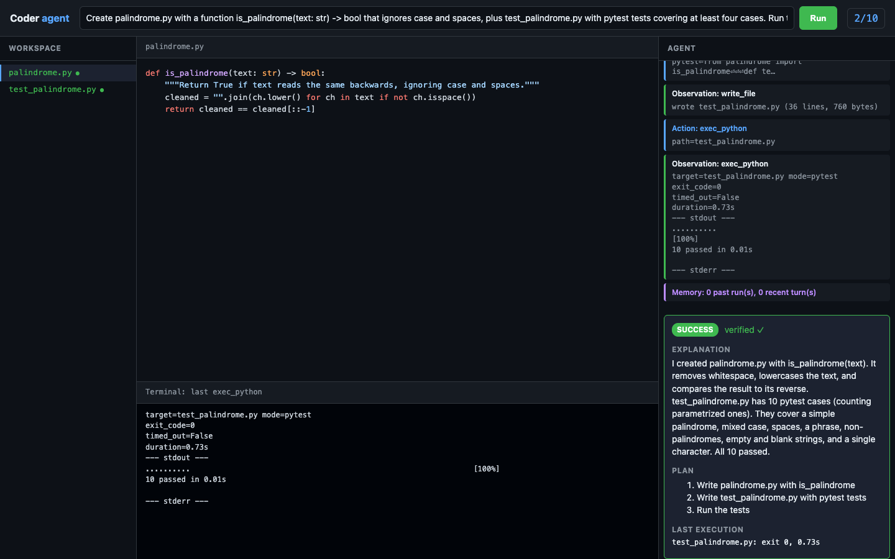
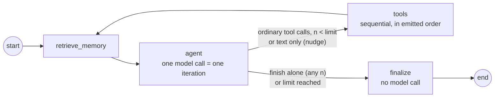

# Multi-Agent Dev Team: the Coder Agent (Module 1)

An autonomous **LangGraph** Coder agent that takes a coding task in plain language, then plans, writes, runs and verifies Python code with **Claude Sonnet**. It works in a bounded ReAct loop (at most 10 model calls), with two memory layers (a sliding window plus Chroma) and three confined tools. Every run ends in a **Pydantic-validated result** whose code is read back from disk and whose result comes from a real execution. It is Module 1 of a five-module capstone: a PM → Coder → QA software team.



## Quickstart

You need Python 3.12+ and [uv](https://docs.astral.sh/uv/). The default model needs an Anthropic API key (see [other providers](docs/usage.md#other-providers)).

**With 1Password** (the key is resolved at runtime from `.env.op`, never written to disk):

```bash
make setup
op run --env-file=.env.op -- make demo
```

**With a plain `.env`:**

```bash
cp .env.example .env        # then set ANTHROPIC_API_KEY
make setup
make demo
```

**With pip instead of uv:**

```bash
python3.12 -m venv .venv && . .venv/bin/activate
pip install -r requirements.txt && pip install -e . --no-deps
coder --demo --reset-memory
```

**With Docker:**

```bash
ANTHROPIC_API_KEY=... docker compose up web               # http://127.0.0.1:8000
ANTHROPIC_API_KEY=... docker compose run --rm coder "task"
```

## CLI

```bash
uv run coder "Write fizzbuzz.py with pytest tests and run them"
uv run coder --json "…"                 # CoderResult JSON on stdout
uv run coder --max-iterations 5 --timeout 5 "…"
uv run coder --reset-memory             # clear window, Chroma and workspace
```

The terminal shows each step live, prefixed `[n/10]`: the memory retrieved, the model's thought, the plan, each action and each observation. It ends with a result panel. Exit codes: 0 success, 1 failed / iteration limit / error, 2 usage error or busy workspace. All flags are in [docs/usage.md](docs/usage.md).

## Web UI

```bash
uv run coder-web      # http://127.0.0.1:8000
```

A read-only "mini-IDE". It shows the workspace file tree, a code viewer that follows the files the agent writes, a terminal strip with the latest run output, a live agent timeline, and the final result card. It runs the same `CoderAgent` code path as the CLI, streamed over server-sent events.

## Architecture



```
agents/         coder_agent.py (CoderAgent), config, model, prompts, result (CoderResult), events
                pm_agent.py, qa_agent.py: placeholders for Modules 2 and 3
tools/          workspace confinement + lock, read_file / write_file, exec_python + _runner, specs, dispatch
memory/         sliding window, Chroma semantic store, context formatting
orchestration/  graph, routing, state, verify, finalize
app/            cli.py (coder), web.py (coder-web), render.py
web/            static mini-IDE (HTML/JS/CSS, no build step)
tests/          unit tests (scripted fake model) + tests/live (real model)
docs/           architecture.md, usage.md, evidence/
```

Details are in [docs/architecture.md](docs/architecture.md).

## Implementation decisions

- **A hand-built LangGraph graph, not `create_react_agent`.** Memory retrieval before every call, the iteration counter, sequential tool execution and a no-LLM finaliser are each a few explicit lines that tests can drive with a scripted fake model.
- **One iteration = one model call; `finish` is a tool.** The agent ends by calling `finish(explanation, plan, entry_point)`. `finalize` never calls the model, so there is no hidden 11th call. Tool calls requested on the 10th call are not executed, because their results could never be seen.
- **Claude Sonnet through `init_chat_model`.** `CODER_MODEL=anthropic:claude-sonnet-5-5` by default. `openai:gpt-4o` or `ollama:<model>` work by changing one variable.
- **Chroma with its default local embedding.** No second API key; Anthropic has no embeddings endpoint. After each run the agent stores what it did (task, outcome, files, plan, summary, defined functions). Retrieval keeps the top 3 within a cosine-distance threshold.
- **Verification from execution records, not hashes alone.** A small runner inside the subprocess records which workspace files each run actually imported, with their hashes at load time. A file is verified only if a successful run after its last write loaded it in its current form. The Pydantic validator refuses `success` without that.
- **One shared workspace with a cross-process lock.** Follow-up tasks build on earlier files. `filelock` makes a second concurrent run fail fast with "workspace busy" instead of corrupting the first.
- **Process-group timeouts.** `exec_python` starts each run in a new session and kills the whole group on timeout, so a script that spawns children can't outlive it. Output is drained by threads into bounded buffers, and stdin is `/dev/null`.

## Rubric evidence

| Criterion | Where in code | How to observe |
|---|---|---|
| **C1.1** Reproducible project | Required tree (`agents/ tools/ orchestration/ tests/ docs/`), `.env.example`, `Dockerfile`, `docker-compose.yml`, `requirements.txt`, `pyproject.toml` + `uv.lock` | `make setup && uv run coder --help` |
| **C1.2** Memory, two layers | `memory/window.py`, `memory/semantic.py`; `retrieve_memory` in `orchestration/graph.py` runs before every `agent` call and puts the result in the system message | `make demo`: the second task's `memory:` lines show the first run retrieved. Tests: `tests/test_graph.py::test_memory_retrieved_before_every_call`, `tests/live/test_smoke.py::test_memory_follow_up`. Transcript: [docs/evidence/cli-transcript.txt](docs/evidence/cli-transcript.txt) |
| **C1.3** Real tools, subprocess, timeout | `tools/file_tools.py`, `tools/exec_python.py`, `tools/_runner.py` (no `eval`/`exec`; enforced by `test_no_eval_in_tools`) | `uv run coder --timeout 2 "Write loop.py containing while True: pass and run it"` gives an observation with `timed_out=True (process tree killed)`. Tests: `tests/test_exec_python.py` (infinite loop, spawned child, output flood). Transcript: [docs/evidence/timeout-probe.txt](docs/evidence/timeout-probe.txt) |
| **C1.4** Bounded ReAct (≤ 10) | `orchestration/routing.py`, `orchestration/graph.py`, cap in `agents/config.py` | `uv run coder --max-iterations 1 "Write fizzbuzz.py … with pytest tests, and run them"` ends with status `iteration_limit` after 1 model call; the tools requested on that last call are not executed. `--max-iterations 11` is rejected (exit 2). Claude batches aggressively, so a limit of 2–3 often isn't reached on small tasks; the unit tests force every limit, including the default 10. Tests: `tests/test_graph.py::test_iteration_limit_forced`, `::test_default_limit_is_ten`. Transcript: [docs/evidence/limit-probe.txt](docs/evidence/limit-probe.txt) |
| **C1.5** Validated output | `agents/result.py` (`CoderResult`, success-consistency validator), `orchestration/verify.py`, `orchestration/finalize.py` | `uv run coder --json "…"`. Example: [docs/evidence/coder-result.json](docs/evidence/coder-result.json). Tests: `tests/test_result.py`, `tests/test_verify.py` (the three regression cases) |
| **C1.6** Verified | `tests/live/test_smoke.py` makes a real model call and asserts every field, that code equals the file on disk, and that `verified` is true | `op run --env-file=.env.op -- make verify` (`REQUIRE_LIVE=1`, so a skip fails). Output: [docs/evidence/verify-output.txt](docs/evidence/verify-output.txt) |

## Known limitations

- **The subprocess is not a security sandbox.** Paths and execution targets are confined to `./workspace/`, but code that `exec_python` runs is a normal host process with full filesystem and network access. Container isolation is the Module 4 work. Run the agent only on tasks you'd run yourself.
- **One run per workspace at a time.** A second concurrent run is refused, not queued.
- **The web UI is local and read-only.** There is no authentication, and it binds to 127.0.0.1 by default.
- **The memory threshold (cosine distance 0.65) is tuned for the default embedding model.** Other embedding models may need `MEMORY_MAX_DISTANCE`.

## Roadmap

| Module | Adds |
|---|---|
| 2 | Product Manager agent: request → spec → Coder (`agents/pm_agent.py`) |
| 3 | QA & Debugger agent: reviews `CoderResult`, writes more tests, loops back with diagnoses (`agents/qa_agent.py`) |
| 4 | MCP / A2A tool and agent interfaces; container-isolated execution |
| 5 | Observability, cost tracking and optimisation |

## LangSmith (optional)

Set `LANGSMITH_TRACING=true`, `LANGSMITH_API_KEY` and `LANGSMITH_PROJECT`. In `.env.op` the key already points at 1Password. LangChain then traces every model call; no code changes are needed.
