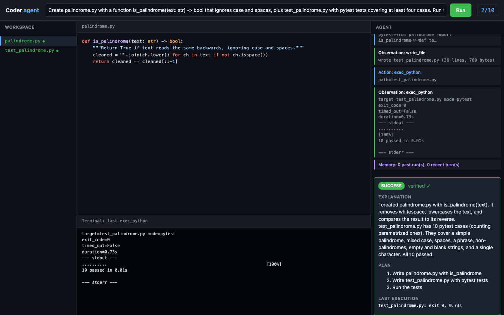
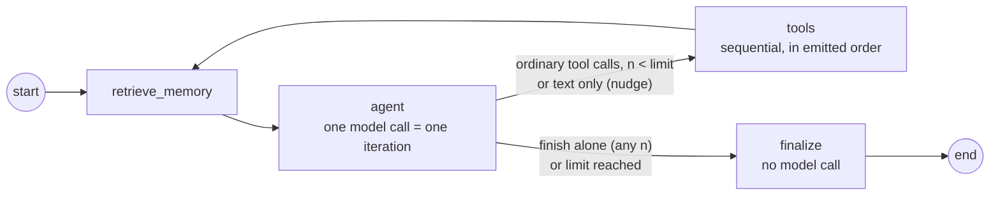
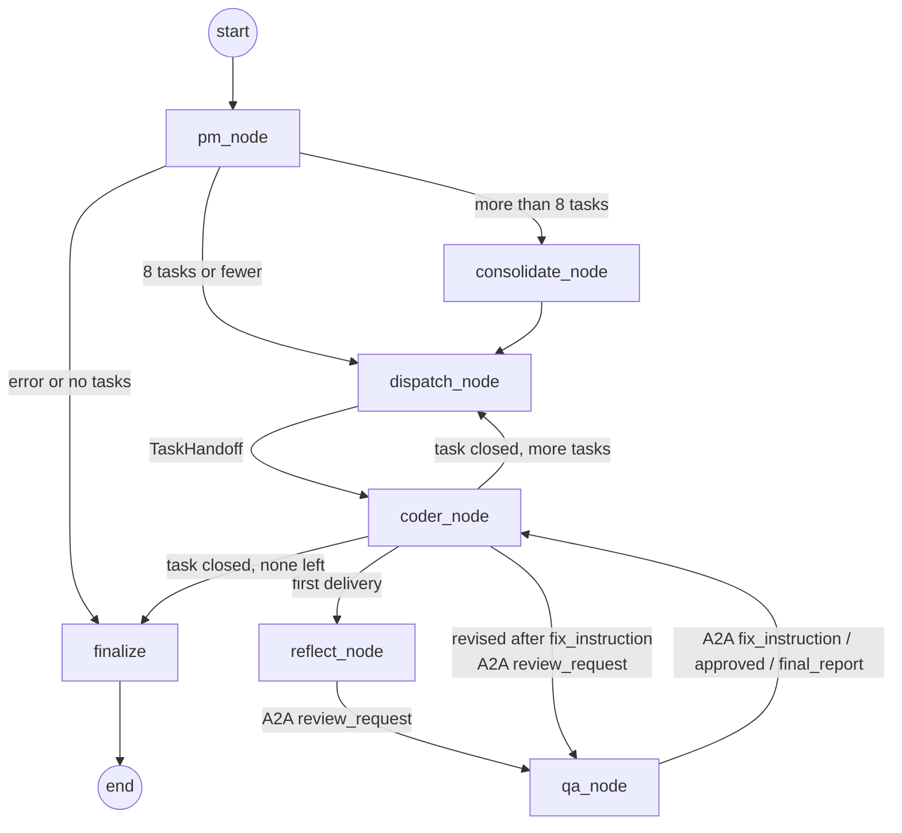
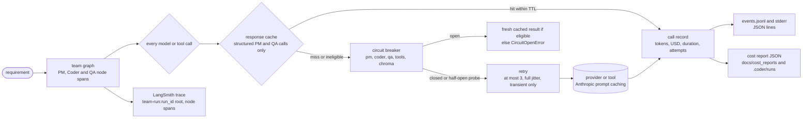

# Multi-Agent Dev Team: PM → Coder ↔ QA (production v4)

An autonomous **LangGraph** Coder agent that takes a coding task in plain language, then plans, writes, runs and verifies Python code with **Claude** (Haiku 5.5 by default; the PM defaults to Sonnet 5.5). It works in a bounded ReAct loop (at most 10 model calls), with two memory layers (a sliding window plus Chroma) and three confined tools. Every run ends in a **Pydantic-validated result** whose code is read back from disk and whose result comes from a real execution. It is Module 1 of a five-module capstone: a PM → Coder ↔ QA software team. Modules 2 and 3 add the PM and QA agents on top, with the Coder and QA talking over A2A (see [v3.0](#v30-pm--coder--qa) and [Why A2A](#why-a2a)). Module 4 hardens that team for production: retries, circuit breakers, a response cache, token and cost reports, LangSmith tracing, structured logs, a clean Docker start and a mocked end-to-end test. Start at [Production v4](#production-v4).



## Quickstart

You need Python 3.11+ and [uv](https://docs.astral.sh/uv/). The default model needs an Anthropic API key (see [other providers](docs/usage.md#other-providers)).

**With 1Password** (the key is resolved at runtime from `.env.op`, never written to disk):

```bash
make setup
op run --env-file=.env.op -- make demo
```

**With a plain `.env`:**

```bash
cp .env.example .env        # then set ANTHROPIC_API_KEY
make setup
make demo
```

**With pip instead of uv:**

```bash
python3.11 -m venv .venv && . .venv/bin/activate
pip install -r requirements.txt && pip install -e . --no-deps
coder --demo --reset-memory
```

**With Docker:** plain `docker compose up --build` runs the whole team on the BST demo against a Chroma service. See [Quickstart (Docker)](#quickstart-docker). The single-Coder web UI and CLI are behind Compose profiles:

```bash
docker compose --profile web up web                       # http://127.0.0.1:8000
docker compose run --rm coder "task"                      # the `cli` profile service
```

The container runs as an unprivileged user (uid 1000). On Linux, build with `APP_UID=$(id -u) APP_GID=$(id -g) docker compose build` so files in the mounted `workspace/` stay owned by you.

## CLI

```bash
uv run coder "Write fizzbuzz.py with pytest tests and run them"
uv run coder --json "…"                 # CoderResult JSON on stdout
uv run coder --max-iterations 5 --timeout 5 "…"
uv run coder --reset-memory             # clear window, Chroma and workspace
```

The terminal shows each step live, prefixed `[n/10]`: the memory retrieved, the model's thought, the plan, each action and each observation. It ends with a result panel. Exit codes: 0 success, 1 failed / iteration limit / error, 2 usage or settings error, busy workspace or Chroma unreachable. All flags are in [docs/usage.md](docs/usage.md).

## Web UI

```bash
uv run coder-web      # http://127.0.0.1:8000
```

A read-only "mini-IDE". It shows the workspace file tree, a code viewer that follows the files the agent writes, a terminal strip with the latest run output, a live agent timeline, and the final result card. It runs the same `CoderAgent` code path as the CLI, streamed over server-sent events.

## Architecture



```
agents/         coder_agent.py (CoderAgent), config, model, prompts, result (CoderResult), events
                pm_agent.py (PMAgent, v2)
                qa_agent.py (QAAgent, v3): writes pytest suites from the criteria, runs them in a sandboxed
                subprocess, parses failures into fix instructions, computes approval in code
tools/          workspace confinement + lock, read_file / write_file, exec_python + _runner, specs, dispatch
memory/         sliding window, Chroma semantic store, context formatting
orchestration/  graph, routing, state, verify, finalize (v1 inner graph)
                team_graph, project_state, handoff, consolidation, team_runner (v2 outer graph)
                a2a (v3 message protocol and broker), review (QA and reflection models)
app/            cli.py (coder), web.py (coder-web), team_cli.py (team), api_check.py, render.py
web/            static mini-IDE (HTML/JS/CSS, no build step)
tests/          unit tests (scripted fake model) + tests/live (real model)
docs/           architecture.md, usage.md, evidence/
```

Details are in [docs/architecture.md](docs/architecture.md).

## Implementation decisions

- **A hand-built LangGraph graph, not `create_react_agent`.** Memory retrieval before every call, the iteration counter, sequential tool execution and a no-LLM finaliser are each a few explicit lines that tests can drive with a scripted fake model.
- **One iteration = one model call; `finish` is a tool.** The agent ends by calling `finish(explanation, plan, entry_point)`. `finalize` never calls the model, so there is no hidden 11th call. Tool calls requested on the 10th call are not executed, because their results could never be seen.
- **Claude through `init_chat_model`, one model per role.** As of v4 the defaults are `PM_MODEL=anthropic:claude-sonnet-5-5`, `CODER_MODEL=anthropic:claude-haiku-5-5` and `QA_MODEL=anthropic:claude-haiku-5-5` (this changes the `coder` and `coder-web` default too). `openai:gpt-4o` or `ollama:<model>` work by changing one variable.
- **Chroma with its default local embedding.** No second API key; Anthropic has no embeddings endpoint. After each run the agent stores what it did (task, outcome, files, plan, summary, defined functions). Retrieval keeps the top 3 within a cosine-distance threshold.
- **Verification from execution records, not hashes alone.** A small runner inside the subprocess records which workspace files each run actually imported, with their hashes at load time. A file is verified only if a successful run after its last write loaded it in its current form. The Pydantic validator refuses `success` without that.
- **One shared workspace with a cross-process lock.** Follow-up tasks build on earlier files. `filelock` makes a second concurrent run fail fast with "workspace busy" instead of corrupting the first.
- **Process-group cleanup.** `exec_python` starts each run in a new session and kills the whole group when the run ends (timeout or not), so a script that spawns children can't outlive it. Workspace modules always compile from current source, never from a cached `.pyc`. Output is drained by threads into bounded buffers, and stdin is `/dev/null`.

## Rubric evidence

| Criterion | Where in code | How to observe |
|---|---|---|
| **C1.1** Reproducible project | Required tree (`agents/ tools/ orchestration/ tests/ docs/`), `.env.example`, `Dockerfile`, `docker-compose.yml`, `requirements.txt`, `pyproject.toml` + `uv.lock` | `make setup && uv run coder --help` |
| **C1.2** Memory, two layers | `memory/window.py`, `memory/semantic.py`; `retrieve_memory` in `orchestration/graph.py` runs before every `agent` call and puts the result in the system message | `make demo`: the second task's `memory:` lines show the first run retrieved. Tests: `tests/test_graph.py::test_memory_retrieved_before_every_call`, `tests/live/test_smoke.py::test_memory_follow_up`. Transcript: [docs/evidence/cli-transcript.txt](docs/evidence/cli-transcript.txt) |
| **C1.3** Real tools, subprocess, timeout | `tools/file_tools.py`, `tools/exec_python.py`, `tools/_runner.py` (no `eval`/`exec`; enforced by `test_no_eval_in_tools`) | `uv run coder --timeout 2 "Write loop.py containing while True: pass and run it"` gives an observation with `timed_out=True (process tree killed)`. Tests: `tests/test_exec_python.py` (infinite loop, spawned child, output flood). Transcript: [docs/evidence/timeout-probe.txt](docs/evidence/timeout-probe.txt) |
| **C1.4** Bounded ReAct (≤ 10) | `orchestration/routing.py`, `orchestration/graph.py`, cap in `agents/config.py` | `uv run coder --max-iterations 1 "Write fizzbuzz.py … with pytest tests, and run them"` ends with status `iteration_limit` after 1 model call; the tools requested on that last call are not executed. `--max-iterations 11` is rejected (exit 2). Claude batches aggressively, so a limit of 2–3 often isn't reached on small tasks; the unit tests force every limit, including the default 10. Tests: `tests/test_graph.py::test_iteration_limit_forced`, `::test_default_limit_is_ten`. Transcript: [docs/evidence/limit-probe.txt](docs/evidence/limit-probe.txt) |
| **C1.5** Validated output | `agents/result.py` (`CoderResult`, success-consistency validator), `orchestration/verify.py`, `orchestration/finalize.py` | `uv run coder --json "…"`. Example: [docs/evidence/coder-result.json](docs/evidence/coder-result.json). Tests: `tests/test_result.py`, `tests/test_verify.py` (the three regression cases) |
| **C1.6** Verified | `tests/live/test_smoke.py` makes a real model call and asserts every field, that code equals the file on disk, and that `verified` is true | `op run --env-file=.env.op -- make verify` (`REQUIRE_LIVE=1`, so a skip fails). Output: [docs/evidence/verify-output.txt](docs/evidence/verify-output.txt) |

## Known limitations

- **The subprocess is not a security sandbox.** Paths and execution targets are confined to `./workspace/`, and since v4 generated code runs with an allowlisted environment (no API keys). It is still a normal process with the filesystem and network access of its user. The Docker image runs it as an unprivileged user, which limits but does not remove that. Run the agent only on tasks you'd run yourself.
- **One run per workspace at a time.** A second concurrent run is refused, not queued.
- **The web UI is local and read-only.** There is no authentication. It binds to 127.0.0.1 by default and refuses foreign `Host` headers (`CODER_WEB_ALLOWED_HOSTS`).
- **The memory threshold (cosine distance 0.65) is tuned for the default embedding model.** Other embedding models may need `MEMORY_MAX_DISTANCE`.

## v3.0: PM → Coder ↔ QA

Module 3 completes the three-agent team. One LangGraph graph (`orchestration/team_graph.py`) takes a free-text requirement and runs three agents over a shared `ProjectState`:

- **PM** (`agents/pm_agent.py`) turns the requirement into a spec with acceptance criteria and a task list.
- **Coder** (`agents/coder_agent.py`) builds each task, critiques its own code once, and revises it.
- **QA** (`agents/qa_agent.py`) writes pytest tests from the task's acceptance criteria, runs them in a subprocess with a timeout, parses the failures into structured fix instructions, and decides approval in code from the test results, never from a model's opinion.

Per task, the loop is: `dispatch_node` hands the task over, `coder_node` delivers, `reflect_node` runs the Coder's self-critique and a revision, then `qa_node` tests the revised code. QA replies `fix_instruction` and the Coder revises and resubmits, or QA replies `approved` or `final_report` and the task closes. A round is one QA test run, and the loop is capped by `QA_MAX_ITERATIONS` (default and maximum 5). The v1 `coder` and `coder-web` commands are unchanged.



The same flow as text:

```
requirement
    │
    ▼
 pm_node ──route_after_pm──┬── error or no tasks ───────────────────────────────► finalize ──► END
                           ├── > 8 tasks ──► consolidate_node ──┐                    ▲
                           └── ≤ 8 tasks ───────────────────────┤                    │
                                                                ▼                    │
              ┌─────────────────────────────────────────► dispatch_node              │
              │                                                 │ TaskHandoff        │
              │                                                 ▼                    │
              │                                            coder_node (deliver)      │
              │                                                 │                    │
              │                                                 ▼                    │
              │                                            reflect_node              │
              │                                         critique, then revise        │
              │                                                 │ A2A review_request │
              │                                                 ▼                    │
              │                                  ┌───────► qa_node                   │
              │                                  │  tests, run, report               │
              │                                  │             │                     │
              │                  A2A review_request            │ A2A reply           │
              │                  (next round)    │             ▼                     │
              │                                  └──── coder_node ◄── fix_instruction
              │                                        (revise)                      │
              │                                                                      │
              │                  approved or final_report: coder_node closes the task│
              │                                                 │                    │
              │                                        route_after_coder             │
              └────────────── more tasks ◄──────────────────────┤                    │
                                                                └── none left ───────┘
```

Reflection runs once per task, on the first delivery. Fix rounds go straight from `coder_node` to `qa_node`. The Coder leaves a task only on an explicit `approved` or `final_report` message from QA.

- `pm_node` drafts a `Spec` (acceptance criteria `AC1…`, tasks `T1…`, each task covering at least one criterion). It is validated, so a task that covers an unknown criterion, or a criterion no task covers, fails the run.
- `consolidate_node` runs only when the PM returns more than 8 tasks. It merges them to at most 8 (model first, deterministic fallback) and records the mapping in `consolidation`.
- `dispatch_node` writes a `TaskHandoff` into state. That is the readiness signal for the Coder.
- `coder_node` runs the existing `CoderAgent` for one task. It delivers the code, revises it from QA's `fix_instruction`, and closes the task when QA sends `approved` or `final_report`. A failed task does not stop the run; the next task still runs and the run ends `partial`.
- `reflect_node` has the Coder critique its own code (likely bugs and edge cases), then revise it. A revision that changes no file is retried once. If there is still no revision, the task cannot be `done`: QA sends `final_report(reason="no_revision")`.
- `qa_node` receives the `review_request`, generates the task's pytest suite on round 1, restores the canonical suites (this task's plus every earlier approved task's) into the workspace, runs them all in one pytest subprocess, and replies. Approval means every manifest test of every suite ran and passed, with no skips and no missing tests.
- On round 1 only, before the suite freezes, QA checks any of its own failing tests against the task's criteria and may replace a test it wrote wrong (same name, spliced in by function, recorded in the QA report's `test_corrections`), then reruns once. Later rounds never change the suite.
- `finalize` re-runs every `done` task's canonical suite against the final workspace. A task whose suite now fails becomes `failed` with outcome `regressed`, and the run is `partial`.

## Why A2A

The Coder ↔ QA exchange is peer agent-to-agent work, so it uses an A2A-style message protocol (`orchestration/a2a.py`), not a tool call and not MCP.

- **Peers, not a tool.** QA is not a function the Coder calls and gets a string back from. It is an agent with its own model, its own sandboxed test runs and its own decision to approve, and the two take turns: review request, fix instruction, revised request, verdict. Modelling that as a tool call would hide the loop that Module 3 is graded on.
- **Correlation ids across rounds.** Every `Message` carries `sender`, `receiver`, `intent`, `payload` and `correlation_id`. QA echoes the id of the request it answers, so a reply is matched to the outstanding `review_request`. The Coder discards a reply carrying any other `correlation_id`, which keeps a stale answer from an earlier round from closing the task.
- **Intent validation at a trust boundary.** There are four intents: `review_request`, `fix_instruction`, `approved` and `final_report`. A `Message` is validated when it is built: both agents must be `coder` or `qa` and differ, the intent must be known, and the payload must validate against that intent's model. On receipt, each agent accepts only what it declared (QA takes `review_request` from the Coder; the Coder takes `fix_instruction`, `approved` and `final_report` from QA). Anything else, or a message for another task, is logged as `rejected` and discarded.
- **A decoupled broker.** Agents hold only the `Broker`, never each other. It keeps one FIFO queue per agent and reports every `sent`, `received` and `rejected` event, which `TeamRunner` appends to `a2a-log.jsonl` after two lines advertising what each agent accepts.
- **Why a synchronous broker, not `asyncio`.** The course's reference broker uses `asyncio.Queue` because its agents are concurrent coroutines. Here the LangGraph nodes run one at a time, so a synchronous `collections.deque` per agent has the same send and receive contract with no event loop to manage. The part that matters, no agent referencing another and all traffic going through the broker, is kept.
- **Why not MCP.** The Coder ↔ QA loop, not file access, is the graded pathway. MCP would reroute the Coder's file tools and touch delivery verification, and it does not model two agents taking turns.

`correlation_id` pairs and the rejected-message records are visible in the `a2a-log.jsonl` of any run.

### Running it

```bash
make team-linked-list                     # the Module 3 grading task, then the linked-list check (live model)
uv run team --demo linked-list --reset-memory --qa-max-iterations 3
uv run team --demo api --reset-memory     # the published task: GET /health + POST /echo (make team-demo)
uv run team --demo large --reset-memory   # an 11-feature requirement, so the PM yields > 8 tasks and consolidation runs (make team-large)
uv run team "Build a CLI that converts CSV to JSON, with tests"
uv run team --json "…"                    # only the final ProjectState JSON on stdout
uv run python scripts/check_api.py        # run the Postman fixture against the generated API in workspace/
```

`--demo api` runs `scripts/check_api.py`'s checks automatically after the Coder finishes and passes only if they do. `--demo linked-list` runs the Module 3 requirement, then checks that every task was approved with tests run, that QA's canonical suites call `insert`, `delete`, `search` and `reverse`, and that the project regression check passed. Flags and exit codes are in [docs/usage.md](docs/usage.md).

Each run writes its evidence to `.coder/runs/<id>/`: `requirement.txt`, `state-after-pm.json`, `handoff-<task>.json`, `reflection-<task>.json`, `qa-<task>-r<n>.json`, `qa-tests-<task>.py`, `a2a-log.jsonl`, `state-after-<task>.json`, `consolidation.json` (when consolidation ran), `regression.json` (when at least one task is done), `api-check.txt` or `demo-check.txt` (for the demos) and `final-state.json`.

**Status timing.** A task's `state-after-<id>.json` and its transcript `task_done` line show the status at the moment the task closed. The end-of-run regression check can later change a `done` task to `failed` (outcome `regressed`). The summary table, `regression.json` and `final-state.json` hold the final status.

### v2 rubric evidence

| Criterion | Where in code | Evidence |
|---|---|---|
| **C2.1** PM agent | `agents/pm_agent.py` | [requirement.txt and state-after-pm.json](docs/evidence/v2/) from the demo run; the spec has at least 2 tasks |
| **C2.2** Shared state | `ProjectState` in `orchestration/project_state.py` | `state-after-pm.json` against `state-after-T1.json` in [docs/evidence/v2/](docs/evidence/v2/) |
| **C2.3** Handoff | `orchestration/team_graph.py`, `render_task` in `orchestration/handoff.py` | `handoff-T1.json` in [docs/evidence/v2/](docs/evidence/v2/); `render_task` tests in `tests/test_team_graph.py` |
| **C2.4** Task tracking and consolidation | `task_status` and `work_in_progress` in `ProjectState`; `orchestration/consolidation.py` | The `state-after-<id>.json` sequence and the `work_in_progress` log; `consolidation.json` from `team --demo large`, all in [docs/evidence/v2/](docs/evidence/v2/) |
| **C2.5** Working end to end | `tests/test_team_graph.py`, `scripts/check_api.py` | The `tests/test_team_graph.py` result, the demo run and the `check_api.py` output on the generated API, in [docs/evidence/v2/](docs/evidence/v2/) |
| **C2.6** Documentation | This section, [docs/architecture.md](docs/architecture.md) | The diagram above is checked against the compiled graph by `tests/test_docs.py` |

### v3 rubric evidence

| Criterion | Where in code | Evidence |
|---|---|---|
| **C3.1** QA agent, real tests | `agents/qa_agent.py`; the pytest subprocess and timeout in `tools/exec_python.py`; JUnit parsing in `tools/junit.py` | `qa-tests-<task>.py` (the suite) and `qa-<task>-r<n>.json` (per-test results, issues tied to the failing test) in any run directory |
| **C3.2** Feedback loop | `qa_node` and `coder_node` in `orchestration/team_graph.py` | [feedback/](docs/evidence/v3/controlled/feedback/): `qa-T1-r1.json` failing assertion, then `fix_instruction` in `a2a-log.jsonl`, then `review_request` round 2 with revised file hashes, then `qa-T1-r2.json` passing |
| **C3.3** Bounded loop | `Settings.qa_max_iterations` (`QA_MAX_ITERATIONS`, default 5, max 5) in `agents/config.py` | [nonconverging/](docs/evidence/v3/controlled/nonconverging/): `final_report`, task `failed`, run `partial`, exit 1. The success exit is in the live run below |
| **C3.4** Self-reflection | `reflect_node`, `CoderAgent.critique` | `reflection-<task>.json` (critique, before and after hashes, changed files). The `review_request` round 1 hashes equal `after` |
| **C3.5** A2A | `orchestration/a2a.py` | `a2a-log.jsonl` (five fields on every message, `correlation_id` pairs, capability lines). Rejected messages: [trust-boundary/](docs/evidence/v3/controlled/trust-boundary/), where a forged `fix_instruction` and an `approved` with a wrong `correlation_id` were injected deliberately and both are logged as `rejected` with a reason while the task still ends `done`. Tests: `tests/test_a2a.py`, `tests/test_team_loop.py` |
| **C3.6** Working, documented | `tests/`, `app/demo_check.py` | The live linked-list run, and this README (protocol rationale and the three-agent diagram) |

### Evidence index: `docs/evidence/v3/`

- [`controlled/feedback/`](docs/evidence/v3/controlled/feedback/), [`controlled/nonconverging/`](docs/evidence/v3/controlled/nonconverging/) and [`controlled/trust-boundary/`](docs/evidence/v3/controlled/trust-boundary/): **scripted PM/Coder/QA models, real pytest subprocess execution.** The transcripts show the model as `scripted`; no model API calls were made. In `trust-boundary`, two forged messages are injected into the broker on purpose, to show the trust boundary rejecting them. Regenerate with `uv run python -m scripts.controlled_runs`.
- `docs/evidence/v3/linked-list/` (live run): the real-model run of the grading demo. Five tasks, all approved; T1 went through a live QA `fix_instruction` round before approval; the regression check passed 109/109 tests. Includes `demo-check.txt`, `a2a-log.jsonl`, the reflection and QA files and `regression.json`.

In every run directory, `state-after-<id>.json` and the transcript `task_done` line show a task's status when it closed. The end-of-run regression check can later change a `done` task to `failed` (outcome `regressed`); the summary table, `regression.json` and `final-state.json` hold the final status.

## Production v4

Module 4 takes the v3 team and makes it operable: every call retried at its boundary, circuit breakers around every dependency, a response cache, token and cost accounting, one LangSmith trace per run, structured logs, validated outputs, a clean Docker start, and tests that run without a key. The agents, the graph above and the A2A protocol are unchanged. The evidence for each rubric criterion (C4.1 to C4.9) is mapped in [docs/evidence/v4/README.md](docs/evidence/v4/README.md).



What v4 changed, in one place:

- **One model per role.** `CODER_MODEL` now sets the Coder only and defaults to Haiku 5.5. `PM_MODEL` defaults to Sonnet 5.5 and `QA_MODEL` to Haiku 5.5. The v1 `coder` and `coder-web` commands use `CODER_MODEL`, so their default changed from Sonnet to Haiku too. Day to day, set `CODER_MODEL=anthropic:claude-sonnet-5-5` for a stronger Coder.
- **Retry at the call boundary** (`resilience/retry.py`, wired in `agents/model.py` and the tool and Chroma call sites). At most 3 retries after the original attempt, full jitter: `uniform(0, min(RETRY_MAX_DELAY_S, RETRY_BASE_DELAY_S * 2**attempt))`, attempt 0-based. Only transient errors are retried (429, timeouts, 5xx and overloaded 529, connection errors, transient OS errors). Permanent errors fail at once, and a program's own exit code or timeout inside `exec_python` is a result, never a failure. Provider SDK retries are disabled (`max_retries=0`), so our wrapper is the only retry layer. A persistent failure stops at the bound without replaying the agent loop.
- **Circuit breakers** (`resilience/breaker.py`): `pm`, `coder`, `qa`, `tools` and `chroma`. A breaker opens after `BREAKER_FAILURE_THRESHOLD` consecutive transient failures (each counted after its retries are exhausted), rejects calls while open, goes half-open after `BREAKER_COOLDOWN_S` and lets exactly one probe through: success closes it, failure reopens it. A success resets the count, a permanent error neither counts nor resets, and a nested `CircuitOpenError` neither counts nor resets. Every transition is logged at WARNING. An open circuit returns a fresh cached result when the call is cache-eligible (event `degraded_fallback_cached`), otherwise raises `CircuitOpenError`, which the agents turn into a reported failure (`failed` run, Coder `error`, QA `qa_error`) rather than a crash.
- **Response cache** (`resilience/cache.py`): on disk under `.coder/cache/`, keyed by a hash of the model, messages, bound tools or schema and parameters, with TTL `CACHE_TTL_S` (default 3600; `0` disables). Only structured PM and QA calls are eligible (PM spec, PM consolidation, QA suite, QA fix plan, QA audit). The Coder's ReAct steps, critique and revision are never cached. **The cache survives `--reset-memory`**, so a second demo run within the TTL shows hits; delete `.coder/cache/` or set `CACHE_TTL_S=0` to bypass it. Separately, Anthropic prompt caching marks the first system message and the last tool, and cache read and write tokens are recorded in the cost report. Models that reject a forced `tool_choice` (sonnet-5-5, opus-5-5, fable-5-1) are called without one.
- **Token and cost accounting** (`observability/costs.py`): one `CallRecord` per successful model call or cache hit, by agent. Prices are per million tokens, as of 2026-11-08 (Haiku cache read is derived as 0.1x input, and Haiku's above-100K-token tier is not modelled). An unknown model logs `unpriced_model` and is costed at $0, flagged in the report.
- **Security.** Generated code and the API-check app run with an allowlisted environment (`tools/exec_python.py::child_env`), so no API key reaches them. Logs and cost-report errors are redacted. Every model output passes a Pydantic schema before it is acted on. The audit is in [docs/evidence/v4/validation-audit.md](docs/evidence/v4/validation-audit.md).
- **Docker.** Compose now starts Chroma, waits for its health check, then runs the BST demo. The `.coder` directory is bind-mounted into the container, so the `reset_memory` cross-process sync (the `.coder/generation` counter) still works.

### Quickstart (Docker)

Grader path, with a plain `.env`:

```bash
cp .env.example .env            # fill in ANTHROPIC_API_KEY (LANGSMITH_* are optional)
docker compose up --build
```

Needs Docker Compose 2.24 or newer: the optional `.env` uses `env_file` with `required: false`.

Plain `docker compose up` runs `team --demo bst --reset-memory` once Chroma reports healthy (the health check is a `bash` `/dev/tcp` GET of `/api/v2/heartbeat` that must return 200, image `chromadb/chroma:1.5.9`), then the `team` container exits and Chroma keeps running, so `docker compose up` does not return on its own: press Ctrl-C once you see `team-1 exited with code 0` (or the code the run ended with). For a one-shot run that stops Chroma when the team finishes, use `docker compose up --build --abort-on-container-exit team`. The run's cost report appears in `docs/cost_reports/` on the host, and its evidence in `.coder/runs/<run_id>/`. To start from nothing, run `docker compose down -v` first.

With 1Password and no plaintext `.env`:

```bash
op run --env-file=.env.op -- docker compose up --build
```

Compose passes variables by bare name, so a value set on the host wins, `.env` (optional) fills the gaps and an unset key stays unset. `OPENAI_API_KEY` is not passed through because the image does not install the `openai` extra. The other services sit behind profiles: `docker compose --profile web up web` (the single-Coder web UI on `127.0.0.1:8000`) and `docker compose run --rm coder "task"` (the `cli` profile). `workspace/`, `.coder/` and `docs/cost_reports/` ship with a `.gitkeep` and must be writable by the build user; on Linux build with `APP_UID=$(id -u) APP_GID=$(id -g) docker compose build`.

### Quickstart (local, 1Password)

```bash
make setup                                  # uv sync
op run --env-file=.env.op -- make team-bst  # = uv run team --demo bst --reset-memory
```

`.env.op` holds `op://` references that `op run` resolves at runtime, so no key is written to disk. Without 1Password, `cp .env.example .env`, set `ANTHROPIC_API_KEY`, and run `make team-bst`. Locally, memory uses an on-disk Chroma at `.chroma/`; set `CHROMA_HOST` (and `CHROMA_PORT`) to use a Chroma server instead.

**The BST demo.** `--demo bst` sends the published task sentence verbatim, followed by an appended interface block titled "the supplied fixture's contract": module `bst.py` at the workspace root; class `BinarySearchTree` with `insert(value) -> None`, `search(value) -> bool` and `inorder() -> list` in ascending order; duplicate inserts ignored; values mutually comparable. After the run, the "BST fixture check" passes only if every task was approved with QA's tests run, and the supplied fixture (`tests/fixtures/bst_fixture.py`, run with `--noconftest`) passes 5 of 5 tests. Line coverage of `bst.py` under QA's tests is reported, not gated.

### Configuration

Set these in the environment or in `.env` (copy `.env.example`; `Settings.from_env` loads the project's own `.env`). Flags override variables. The key is only needed for live runs.

| Variable | Default | Meaning |
|---|---|---|
| `ANTHROPIC_API_KEY` | none | Key for the default models. Not needed for tests. |
| `CODER_MODEL` | `anthropic:claude-haiku-5-5` | Provider-prefixed model for the **Coder only** (flag `--model`). |
| `PM_MODEL` | `anthropic:claude-sonnet-5-5` | Model for the PM (flag `--pm-model`). |
| `QA_MODEL` | `anthropic:claude-haiku-5-5` | Model for QA (flag `--qa-model`). |
| `CODER_PROJECT_DIR` | current directory | Project root that holds `workspace/`, `.coder/`, `.chroma/` and `docs/cost_reports/`. |
| `CODER_MAX_ITERATIONS` | `10` | Model calls per Coder run, 1 to 10 (flag `--max-iterations`). |
| `CODER_MAX_TOKENS` | `8192` | `max_tokens` for each PM and Coder model call. |
| `QA_MAX_TOKENS` | `16384` | `max_tokens` for each QA call: QA writes a whole test module in one reply. A reply cut off at this limit is never cached, and QA retries once, asking for a shorter suite. |
| `QA_MAX_ITERATIONS` | `5` | QA test rounds per task, 1 to 5 (flag `--qa-max-iterations`). A round is one QA test run, so 5 rounds means up to 4 Coder fix runs. |
| `EXEC_TIMEOUT_SECONDS` | `10` | Timeout for each `exec_python` run, including QA's pytest run (flag `--timeout`). |
| `MEMORY_WINDOW_TURNS` | `10` | Sliding-window turns kept by the Coder. |
| `MEMORY_TOP_K` | `3` | Semantic memories retrieved per call. |
| `MEMORY_MAX_DISTANCE` | `0.65` | Cosine-distance cut-off for retrieval. |
| `RETRY_MAX` | `3` | Retries after the original attempt, 0 to 3 (hard cap 3). |
| `RETRY_BASE_DELAY_S` | `1.0` | Backoff base in seconds. |
| `RETRY_MAX_DELAY_S` | `30.0` | Backoff ceiling in seconds. |
| `BREAKER_FAILURE_THRESHOLD` | `3` | Consecutive transient failures that open a breaker. |
| `BREAKER_COOLDOWN_S` | `30.0` | Seconds an open breaker waits before its half-open probe. |
| `CACHE_TTL_S` | `3600` | Response-cache time to live in seconds; `0` disables the cache. |
| `CHROMA_HOST` | unset (local store) | Chroma server host. Compose sets it to `chroma`. |
| `CHROMA_PORT` | `8000` | Chroma server port. |
| `LOG_LEVEL` | `INFO` | Level for the structured logs. |
| `LANGSMITH_TRACING` | `false` | Set `true` to trace (also needs `LANGSMITH_API_KEY`). |
| `LANGSMITH_API_KEY` | none | LangSmith key. Tracing is on only when both this and `LANGSMITH_TRACING=true` are set. |
| `LANGSMITH_PROJECT` | unset (LangSmith uses `default`) | LangSmith project for the traces. `.env.example` sets `multi-agent-dev-team`. |
| `OPENAI_API_KEY`, `OLLAMA_BASE_URL` | none | For `openai:` and `ollama:` models (install the matching extra). |
| `CODER_WEB_HOST`, `CODER_WEB_PORT`, `CODER_WEB_ALLOWED_HOSTS` | `127.0.0.1`, `8000`, local names | `coder-web` only. |

An invalid value (for example `QA_MAX_ITERATIONS=6`) exits with code 2 and "invalid setting".

### Callable interface

**`team` CLI** (`app/team_cli.py`, `uv run team ...`):

| Flag | Meaning |
|---|---|
| `requirement` | The free-text requirement. Give a requirement, `--demo` or `--reset-memory`, never a requirement together with `--demo`. |
| `--demo api` | The Module 2 task (GET /health, POST /echo with FastAPI), then the Postman fixture check (`make team-demo`). |
| `--demo large` | An 11-feature requirement, so the PM yields more than 8 tasks and consolidation runs (`make team-large`). |
| `--demo linked-list` | The Module 3 task, then the linked-list check (`make team-linked-list`). |
| `--demo bst` | The binary-search-tree task plus the fixture's contract, then the BST fixture check (`make team-bst`). This is the Docker default. |
| `--model M` | Coder model, for example `anthropic:claude-haiku-5-5` or `openai:gpt-4o`. |
| `--pm-model M`, `--qa-model M` | PM and QA models. |
| `--max-iterations N` | Per-task Coder model-call limit, 1 to 10. |
| `--qa-max-iterations N` | QA test rounds per task, 1 to 5. |
| `--timeout S` | `exec_python` timeout in seconds. |
| `--reset-memory` | Clear Chroma, the sliding window and the workspace first; alone, it does only that and exits 0. The response cache is kept. |
| `--json` | Print only the final `ProjectState` JSON on stdout; progress goes to stderr. |

The v1 commands are `coder` (`app/cli.py`) and `coder-web` (`app/web.py`); see [docs/usage.md](docs/usage.md).

**Python API.**

```python
from agents.config import Settings
from agents.model import make_model
from orchestration.team_runner import TeamRunner

settings = Settings.from_env()                 # env + the project's .env; keyword overrides win
runner = TeamRunner(settings)                  # PM, Coder and QA built from settings
state = runner.run("Build a CLI that converts CSV to JSON, with tests")   # final ProjectState as a dict
for event in runner.stream("..."):             # TeamEvent(kind, task_id, data): start, spec, handoff,
    ...                                        # coder, reflection, qa_report, a2a, task_done, final, ...
runner.run_dir, runner.final_state, runner.cost_report_path   # set by run() and stream()
model = make_model(settings, "pm")             # role in {"pm", "coder", "qa"}; a ResilientChatModel
```

- `TeamRunner.stream(requirement, *, api_check=None, demo_check=None)` yields events and writes the run's evidence under `.coder/runs/<run_id>/`. The optional checks are called after the graph finishes and recorded in the `final` event. `TeamRunner.reset_memory()` must not be called while a run is streaming.
- `make_model(settings, role)` resolves the role's model, builds the provider model with SDK retries off, and wraps it with retry, the role's circuit breaker, the response cache (for eligible calls) and call recording. `agents.model.provider_prerequisite(model)` returns the reason a model cannot be called (a missing key, an unreachable Ollama), or `None`.

**Cost report JSON** (`docs/cost_reports/<run_id>.json`, with an identical copy at `.coder/runs/<run_id>/cost-report.json`):

| Key | Content |
|---|---|
| `run_id`, `started_at`, `finished_at`, `requirement` | Run identity and timing (UTC ISO 8601). |
| `outcome` | `success`, `unresolved`, `failed` or `aborted`. |
| `error` | `null`, or `{type, message}` (redacted) for an aborted run. |
| `models` | The model used by each role. |
| `pricing` | `as_of` plus the USD-per-million-token prices (`input`, `output`, `cache_read`, `cache_write`) of the models used. |
| `trace_url` | The LangSmith root-trace URL, or `null` when tracing is off or the URL could not be resolved. |
| `calls` | One record per successful model call or response-cache hit: `ts`, `role`, `agent`, `model`, `prompt_tokens`, `completion_tokens`, `cache_read_tokens`, `cache_write_tokens`, `cache_hit`, `cost_usd`, `priced`, `duration_ms`, `attempts`. |
| `agents` | `pm`, `coder` and `qa`, each with `calls`, `prompt_tokens`, `completion_tokens`, `cache_read_tokens`, `cache_write_tokens`, `cache_hits`, `cost_usd`. |
| `total` | The same fields over all calls. |
| `unpriced_models` | Models with no price entry (costed at $0). |

Totals are computed from `calls`, so they reconcile by construction. A failed LLM attempt that is retried produces no record, so `calls` counts successful model calls plus cache hits, and `attempts` on a record shows how many tries that call needed.

**Log events** (JSON lines, see below): `run_start`, `llm_call`, `tool_call`, `retry_attempt`, `retry_exhausted`, `breaker_transition`, `cache_hit`, `cache_miss`, `cache_expired`, `degraded_fallback_cached`, `trace`, `agent_end`, `run_aborted`, `run_end`, `cost_report_failed`, `unpriced_model`, plus the `*_fallback` warnings for PM consolidation and QA's fix plan and audit.

### Running the tests

```bash
make test        # uv run pytest: the mocked suite, no network and no paid calls (addopts: -m "not live")
make verify      # REQUIRE_LIVE=1 uv run pytest -m live -rs: real-model tests, costs money; a skip counts as a failure
uv run pytest tests/test_e2e_bst.py -v    # the deterministic full-pipeline E2E, mocked
```

The default suite scripts the model (`tests/fakes.py::ScriptedChatModel`) but runs the real graph, tools, `exec_python`, QA's pytest subprocess and the supplied BST fixture. Never run the live tests by accident: `tests/live/` needs a key and spends money. Controlled runs that need no key regenerate the committed evidence: `uv run python -m scripts.controlled_runs` (v3 scenarios) and `uv run python -m scripts.resilience_runs` (retry, breaker, cache, invalid output).

### Traces, logs and cost reports

- **Traces (LangSmith).** Tracing is on only when `LANGSMITH_TRACING=true` and `LANGSMITH_API_KEY` are both set (`LANGCHAIN_API_KEY` alone is not recognised). Otherwise it is a silent no-op and the run is unaffected. Each team run has one root trace named `team-run:<run_id>` (type chain, metadata `run_id`), under which LangGraph's run and then each node execution appear as spans. Node spans carry `agent_name`, `token_count`, `tool_calls`, `tool_names` and `duration_ms`; `pm_node` and `consolidate_node` report as `pm`, `coder_node` and `reflect_node` as `coder`, `qa_node` as `qa`. The values come from the same call records as the cost report. The URL is resolved at run end (waiting at most 5 seconds), logged as the `trace` event and stored in the cost report's `trace_url`. Public trace of the graded BST run `e0d27f3759ec`, no sign-in needed: <https://smith.langchain.com/public/9107463c-0369-449d-9b0f-ec44d131853d/r> (all live runs are listed in [docs/evidence/v4/README.md](docs/evidence/v4/README.md#live-runs)).
- **Logs.** Every event is one JSON line with `ts`, `level`, `run_id`, `agent`, `event` and event fields, written to stderr and to `.coder/runs/<run_id>/events.jsonl`. Secrets are redacted. Follow a run with `jq 'select(.run_id=="<run_id>")' .coder/runs/<run_id>/events.jsonl`, or `grep breaker_transition` for the breaker history.
- **Cost reports.** `docs/cost_reports/<run_id>.json` and `.coder/runs/<run_id>/cost-report.json`, written automatically at the end of every run (success, unresolved, failed or aborted). The CLI prints `cost report: <path>` after the summary, or `cost report: unavailable (see events.jsonl)` if neither copy could be written (the event `cost_report_failed` says why).
- **Other run evidence.** `.coder/runs/<run_id>/` also holds `requirement.txt`, `state-after-*.json`, `handoff-*`, `reflection-*`, `qa-*`, `a2a-log.jsonl`, `regression.json`, the demo's `demo-check.txt` or `api-check.txt`, and `final-state.json`.

### Reading the outcome

| Exit code | Meaning |
|---|---|
| `0` | The run `completed` (every task done, approved by QA and still passing the final regression check). For `--demo api`, `--demo linked-list` and `--demo bst`, the demo's check also passed. The cost report's `outcome` is `success`. `--reset-memory` alone also exits 0. |
| `1` | The run ended `partial` (cost-report `outcome: unresolved`) or `failed` (`failed`), or a demo's check failed. `partial` means at least one task could not be approved within the QA round limit, regressed, or could not be regression-checked (the check itself crashed); the summary prints an `unresolved:` line per open issue, and `final-state.json` holds each task's `unresolved` list. `failed` means the run produced no usable result (for example the PM could not produce a valid spec, or the PM's own dependency stayed down and its circuit opened; a Coder or QA outage ends the task as unresolved (`partial`)). |
| `2` | Usage error (no requirement, or a requirement together with `--demo`), configuration error (invalid setting or a missing provider prerequisite), a busy workspace (another run holds the lock), or Chroma unreachable when `CHROMA_HOST` is set. Also applies to `coder` and `coder-web`. No model call was made and no report was written. |
| `130` | Interrupted with Ctrl-C. The lock is released and the cost report is written with `outcome: aborted`. |

A demo can fail its check while the run itself is `completed`, so read the "BST fixture check: PASSED/FAILED" line and `demo-check.txt` as well as the exit code. The cost report's `outcome` always matches: `completed` is `success`, `partial` is `unresolved`, `failed` is `failed`, and an exception or early close is `aborted`.

### Test map

| Rubric item | Test file |
|---|---|
| PM agent unit | `tests/test_pm_agent.py` |
| Coder agent unit | `tests/test_coder_agent.py` (with `tests/test_graph.py`, `tests/test_reflection.py`) |
| QA agent unit | `tests/test_qa_agent.py` |
| PM → Coder handoff (integration) | `tests/test_team_graph.py` |
| Coder ↔ QA loop termination (integration) | `tests/test_team_loop.py` |
| End to end, mocked (runs the generated BST against the supplied fixture) | `tests/test_e2e_bst.py` |
| End to end, live | `tests/live/test_team_demo.py::test_bst_demo_passes_supplied_fixture` |
| Retry | `tests/test_retry.py`, `tests/test_resilient_model.py` |
| Circuit breaker | `tests/test_breaker.py` |
| Response cache | `tests/test_cache.py` |
| Token and cost accounting | `tests/test_costs.py` |
| Tracing | `tests/test_tracing.py` |
| Structured logs | `tests/test_logs.py` |
| Security (env allowlist, invalid output never reaches tools) | `tests/test_security.py` |
| Models per role, settings | `tests/test_model.py`, `tests/test_config.py` |
| CLI, demo checks | `tests/test_team_cli.py`, `tests/test_demo_check.py` |
| Docs (this README against the code) | `tests/test_docs.py` |

## Roadmap

| Module | Adds |
|---|---|
| 2 | Product Manager agent: request → spec → Coder (`agents/pm_agent.py`) |
| 3 (built, v3.0) | QA & Debugger agent: writes tests from the acceptance criteria, runs them, loops back with fix instructions over A2A (`agents/qa_agent.py`, `orchestration/a2a.py`) |
| 4 (built, v4) | Production hardening: [retries, circuit breakers, response cache, cost reports, LangSmith tracing, structured logs, Docker clean start](#production-v4) (A2A is used between Coder and QA) |
| 5 | Further optimisation (not built here) |

## LangSmith (optional)

See [Traces, logs and cost reports](#traces-logs-and-cost-reports). Tracing is off unless `LANGSMITH_TRACING=true` and `LANGSMITH_API_KEY` are both set.
