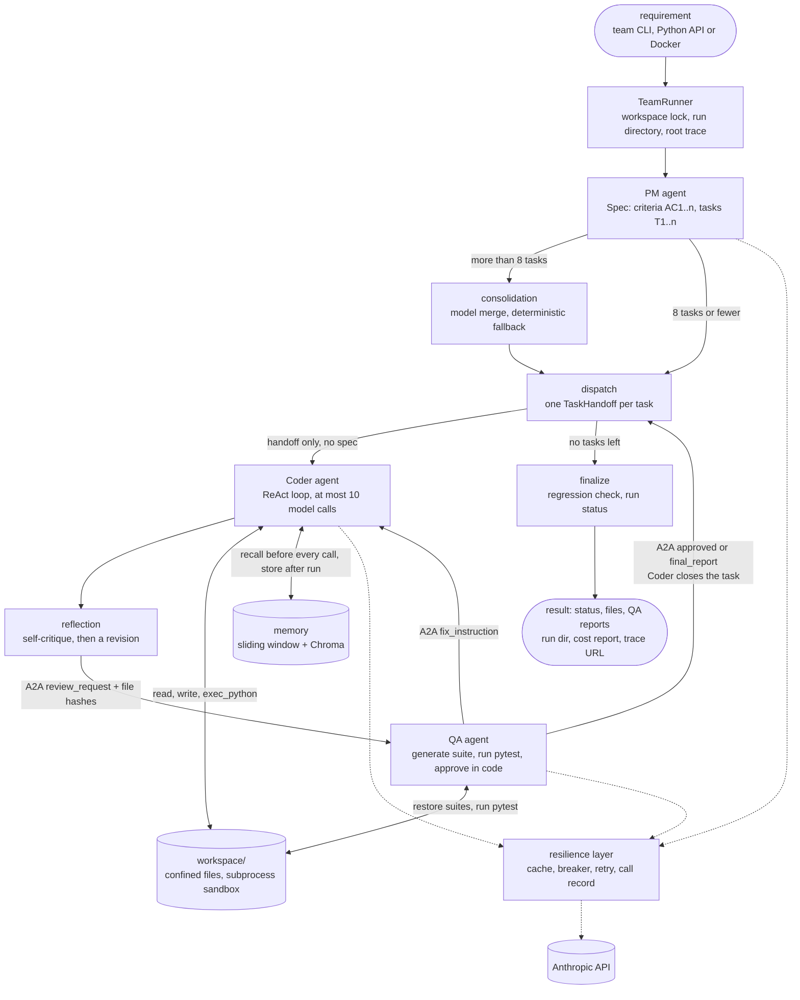
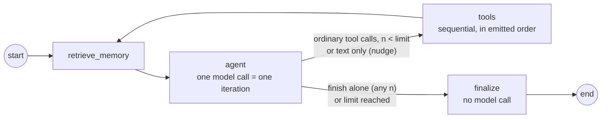

# Architecture

## System overview

Multi-Agent Dev Team turns a plain-language software requirement into working, tested Python code in a sandboxed `workspace/`. Three agents run inside one LangGraph state graph. A **PM** agent writes a validated specification: numbered acceptance criteria, plus up to eight build-ordered tasks that cover them. For each task, a **Coder** agent writes and runs code in a bounded ReAct loop, then critiques and revises its own work. A **QA** agent then writes an independent pytest suite from the task's criteria, runs it, and either approves the task or sends back fix instructions, for at most five rounds. The Coder and QA talk only through typed A2A messages on a broker. Approval is computed in code from test results, never by a model. When every task has closed, a regression check re-runs every approved suite against the final workspace. Every model, tool and vector-store call goes through one resilience layer: response cache, circuit breaker, retry with jitter, and a cost record. Each run leaves behind a run directory of evidence, a cost report and, when enabled, a LangSmith trace. The system runs from the `team` CLI, a Python API or `docker compose up`.

## Data flow



Solid arrows are the data that moves between steps; dotted arrows are model calls. The node-level graph that LangGraph actually compiles is in the [README](../README.md#v30-pm--coder--qa), and `tests/test_docs.py` checks that diagram against the compiled graph. The resilience layer's own flow is in the [README's Production v4 section](../README.md#production-v4).

What crosses each boundary:

| From → to | Carries | Defined in |
|---|---|---|
| user → PM | the requirement string | `app/team_cli.py`, `orchestration/team_runner.py` |
| PM → dispatch | `Spec` (criteria, tasks, `covers` links), validated by Pydantic | `orchestration/project_state.py` |
| dispatch → Coder | `TaskHandoff`: one task, its criteria, its position, the files earlier tasks produced | `orchestration/handoff.py` |
| Coder → QA | `review_request`: task id, round, SHA-256 of every file the task wrote | `orchestration/a2a.py` |
| QA → Coder | `fix_instruction` (issues with root cause and fix), `approved`, or `final_report` | `orchestration/a2a.py`, `orchestration/review.py` |
| finalize → user | `ProjectState`: status, per-task records, QA reports, regression result, cost totals | `orchestration/project_state.py`, `observability/costs.py` |

## The agents

Each agent has one job. Models make the creative decisions: what to build, what code to write and what to test. Code makes the decisions that must be reliable: when a loop stops, whether output is valid, and whether a task passes.

| Agent | Default model | Role |
|---|---|---|
| PM | `claude-sonnet-5-5` (`PM_MODEL`) | Turns the requirement into a testable spec and a build order |
| Coder | `claude-haiku-5-5` (`CODER_MODEL`) | Writes and runs code for one task at a time, critiques and revises it, applies QA's fixes |
| QA | `claude-haiku-5-5` (`QA_MODEL`) | Writes an independent test suite for each task, runs it, and returns approval or fix instructions |

### PM agent (`agents/pm_agent.py`)

**Role.** Turn a requirement into a `Spec`: numbered acceptance criteria `AC1…ACn`, including the error cases the requirement implies, and tasks `T1…Tn` in build order. Each task has its own checkable criteria, a priority, and `covers`, the spec criteria it satisfies.

**Decision logic.**

- **Model:** decomposes the requirement, using structured output against the `Spec` schema. The prompt asks for one task per independently testable unit, each sized to fit within the Coder's 10 calls.
- **Code:** validates the result. Extra fields are rejected, every spec criterion must be covered by some task, and `covers` may only name criteria that exist. An invalid spec gets one retry, with the validation errors fed back to the model. A second failure, or a provider failure, raises `PMError`, and the run ends `failed` with its final state written. It never continues with a bad plan.
- **Too many tasks:** with more than 8 (`MAX_TASKS`), a second model call groups them into contiguous runs, and the grouping is validated. Any failure falls back to a deterministic split, logged at WARNING.

### Coder agent (`agents/coder_agent.py`, `orchestration/graph.py`)

**Role.** Build one task at a time in the shared workspace, on top of the files earlier tasks produced. It sees only its `TaskHandoff`, never the full spec.

**Decision logic.**

- **Model:** chooses each step in a ReAct loop. Memory is retrieved before every model call. The model reads and writes files, runs code with `exec_python` and ends by calling `finish`.
- **Code (routing, `orchestration/routing.py`):** decides what happens to each reply.
  - `finish` alone ends the run.
  - `finish` mixed with other calls is rejected.
  - Ordinary tool calls run in order while fewer than 10 model calls have been made.
  - A text-only reply gets a nudge.
  - At the limit, nothing further runs and the status is `iteration_limit`.
- **No-model finaliser:** builds `CoderResult` from state and from the files on disk. `status="success"` is refused unless the last run passed and every delivered file was loaded, with its current hash, by a successful run after its last write.
- **Reflection (`reflect_node`):** runs once per task. The Coder critiques its own code (1–8 concrete bugs or edge cases), then revises it. The revision must change a file; otherwise the pair is retried once. If it still fails, QA runs one diagnostic round and closes the task as `no_revision`.
- **Revision rounds:** in each round the Coder gets QA's `fix_instruction`, revises, re-hashes its files and sends the next `review_request`.

### QA agent (`agents/qa_agent.py`)

**Role.** Check each task independently of the Coder's own tests, and tell the Coder exactly what to fix.

**Decision logic.**

- **Model:** writes a pytest suite from the task's numbered criteria in round 1 (one retry if the suite is invalid). After failures, it writes a fix plan, as `{test, root_cause, fix}`, from those failures.
- **Code:** everything that decides the verdict.
  - **Freshness:** each file's hash on disk must match the request.
  - **Tamper check:** the suite and every earlier approved suite are restored from canonical copies outside the workspace before every run.
  - **Isolated run:** the suites run in one pytest subprocess under QA's own pytest config, with a timeout and JUnit output.
  - **Reconciliation:** results are matched against each suite's manifest. A failed, errored, skipped or missing test, a timeout or unreadable output is a High issue.
- **Approval:** requires every manifest test to run and pass, exit code 0, no timeout and no High issue. A model cannot approve a task.
- **Reply order:** `no_revision` if reflection made no change, then `approved`, then `final_report(qa_error)` if QA itself failed, then `final_report(max_iterations)` at the round limit (`QA_MAX_ITERATIONS`, default 5), and otherwise `fix_instruction`.

### Supporting components (not agents)

- **TeamRunner** (`orchestration/team_runner.py`). Holds the workspace lock for the whole project and creates the run directory and run context. It streams events to the CLI, and it always writes the final state and cost report, including when a run aborts.
- **Broker** (`orchestration/a2a.py`). Validates messages when they are built and again when they are received, where it is the trust boundary. Agents hold the broker, never each other.
- **Resilience layer** (`agents/model.py`, `resilience/`). Wraps every model, tool and Chroma call.
- **Memory** (`memory/`). A sliding window of past turns plus a Chroma semantic store of past runs.

## Orchestration framework: LangGraph

The system uses **LangGraph** (`StateGraph`). There are two graphs: the Coder's inner ReAct graph, and the team graph that runs it inside `coder_node`. Both are hand-built rather than taken from the prebuilt agents.

Why LangGraph:

- **Control flow is code, not a prompt.** The rubric's hard limits (10 Coder calls, 5 QA rounds, at most 8 tasks, tool calls at the limit never executed) are conditional edges and routing functions that tests drive with scripted fake models. The mocked suite of more than 500 tests runs with no API key, because no model ever decides what runs next.
- **Typed shared state with explicit merge rules.** `ProjectState` is a `TypedDict`. Each field has one owning node and a reducer (`operator.add` for logs and reports, `merge_dicts` for task status and code output). This makes it clear who wrote what, and lets the full state stream after every node.
- **Nested graphs.** The Module 1 Coder graph runs unchanged inside the team graph's `coder_node`. Each module added nodes around it without rewriting it.
- **Streaming.** Nodes emit typed `StepEvent`s through `get_stream_writer()`. The CLI, the web UI (server-sent events) and the evidence files all read the same stream.
- **Observability.** LangGraph runs nest under the runner's LangSmith root trace without extra wiring, and each node becomes a span tagged with its agent.

Alternatives, and why they don't fit here:

- **Conversation-driven frameworks** (CrewAI, AutoGen group chat). The agents decide turn order and when to stop. Here the stopping rules and QA approval must be deterministic and testable, so they belong in code.
- **The prebuilt `create_react_agent`.** It hides the points the rubric grades: memory retrieval before every call, the iteration counter, what happens to tool calls at the limit, and a finaliser that makes no model call.
- **A plain Python loop.** It would work for the Coder alone, but the team would need state merging, streaming, nested runs and tracing rebuilt by hand.

A2A messaging sits on top of LangGraph rather than replacing it. The graph decides which node runs next. The broker carries what the Coder and QA say to each other and validates it.

## Component reference

The sections below document each component in detail. Headings note the module in which each part was added.

### The Coder's inner graph (v1)

The Coder agent is a hand-built LangGraph `StateGraph`, not the prebuilt ReAct agent. The rubric-critical behaviour stays explicit and testable: memory retrieval before every model call, the iteration counter, sequential tool execution, and a finaliser that builds the validated result without asking the model.



| Node | Code | What it does |
|---|---|---|
| `retrieve_memory` | `orchestration/graph.py` | Queries Chroma with the task plus the latest observation, formats the hits and the sliding window into a `# Memory` block, and emits a `memory` event. It runs before **every** `agent` call. |
| `agent` | `orchestration/graph.py` | Sends `SystemMessage(SYSTEM_PROMPT + memory)` plus the run's messages to the model. It increments `iterations`, extracts a numbered plan, and classifies the reply (see routing). |
| `tools` | `orchestration/graph.py`, `tools/dispatch.py` | Answers rejected calls, runs the remaining calls one by one, and appends a `ToolMessage` for each. The first `ToolError` skips the rest of the batch. A non-zero exit code or a timeout is an observation, not an error. |
| `finalize` | `orchestration/finalize.py` | Builds `CoderResult` from state and from the files on disk, then runs delivery verification. It makes no model call. |

The system message is rebuilt for each call and never stored in state. Memory therefore reaches every call, and the stored conversation stays exactly what the model said and observed.

### Coder routing precedence (v1)

`orchestration/routing.py::classify`. *n* is the number of model calls so far, including this one. The top matching rule wins.

1. **`finish` is the only call.** Its arguments are validated, then the run finalizes. This also applies at *n* = limit. Invalid arguments are rejected with an observation and treated as rule 4.
2. **`finish` mixed with other calls.** `finish` is rejected ("finish must be called alone, after your last action") and the other calls fall through to rule 3.
3. **Ordinary calls.** They execute if *n* < limit. At the limit they are **not** executed, because the agent could never see their results. Status becomes `iteration_limit`.
4. **No tool calls.** The agent is nudged to call a tool or finish if *n* < limit; otherwise status becomes `iteration_limit`.

The limit is `CODER_MAX_ITERATIONS` (default and hard cap: 10). `Settings` rejects anything outside 1–10. LangGraph's `recursion_limit` (3 × limit + 5) is only a backstop.

### Tools and the execution record (v1)

- **Confinement** (`tools/workspace.py`). Every file-tool path and every execution target is resolved, following `..` and symlinks, and must lie inside `./workspace/`. A leading `workspace/` prefix is stripped, because models often add one.
- **`exec_python`** (`tools/exec_python.py`). It runs `sys.executable -s tools/_runner.py <mode> <target> …` with `cwd=workspace`, `stdin=/dev/null`, and its own process group.
  - When the run ends, the **whole process group** is killed with `SIGKILL`, including any children the script spawned. On timeout (default 10 s) that happens early.
  - Bytecode is cached outside the workspace, and the runner drops the workspace's cached modules before each run. A same-size rewrite within one second can't run stale `.pyc` code.
  - Output is drained by reader threads that keep the first 8,000 bytes per stream. A print flood can't deadlock the run or fill memory or disk.
  - Test files (`test_*.py`, `*_test.py`) run under pytest. Inline code is written to `.coder_snippets/` first, so every executed artifact exists on disk.
- **The runner** (`tools/_runner.py`) runs inside the child process. It installs a `MetaPathFinder` that records the SHA-256 of every workspace module at the moment it is imported, plus the target itself. At exit it also sweeps `sys.modules` for workspace files loaded by other importers, such as `conftest.py` loaded by pytest's assertion rewriter. It writes the result to a JSON record.
- **Files written by executed code.** `.py` files that a run creates or changes, rather than `write_file`, count as writes made at that step. They are reported in the observation, delivered, and need a later successful run to be verified.
- **Verification** (`orchestration/verify.py`). A delivered `.py` file is verified only if some successful run after its last write loaded it with the hash it has on disk now. So "wrote A, ran it, overwrote with B, finished" is reported `failed`, and so is a broken module that was never imported by the passing run. `CoderResult`'s model validator then refuses `status="success"` unless the last run passed and delivery is verified.

### Memory (v1)

- **Sliding window** (`memory/window.py`). The last N conversation turns, where a turn is a task plus the agent's final explanation (`MEMORY_WINDOW_TURNS`, default 10). It lives in the process. The current run's ReAct messages are never trimmed; the 10-call cap bounds them.
- **Semantic store** (`memory/semantic.py`). A Chroma `PersistentClient` at `./.chroma/`, using cosine distance and Chroma's default local embedding (all-MiniLM-L6-v2 via ONNX, no API key).
  - After each run the agent stores its task, outcome, files, plan, summary, and the names of the top-level functions and classes it delivered.
  - Retrieval returns the top 3 hits with distance ≤ 0.65.
- **Reset** (`CoderAgent.reset_memory`). Under the workspace lock, it clears Chroma, the workspace, and the window, and bumps a generation counter in `.coder/generation`. Every process checks the counter at the start of each run and drops its stale window, so a reset from the CLI also reaches an idle web server.

### Concurrency (v1)

There is one active run per workspace across processes, enforced by `filelock` on `.coder/workspace.lock` with a non-blocking acquire. A second run gets "workspace busy": exit code 2 in the CLI, HTTP 409 in the web UI. The holder also writes its pid to `.coder/running`. The web UI's status poll reads that marker instead of probing the lock, so polling can never make a starting run see "busy". The Run button stays disabled while any live process holds the lock.

### Streaming (v1)

`CoderAgent.stream(task)` yields `StepEvent`s (`start`, `memory`, `thought`, `plan`, `action`, `observation`, `nudge`, `limit`, `error`, `result`). Graph nodes emit them with `get_stream_writer()`, and the agent reads them with `stream_mode=["custom", "values"]`. The CLI renders them with rich. The web server forwards them as server-sent events on `POST /api/run`. A dedicated thread drives each run. When the browser disconnects, that thread stops at the next event and closes the run, which releases the lock.

### Team graph: PM → Coder (v2)

Module 2 wraps the Coder in an outer graph (`orchestration/team_graph.py`, built by `build_team_graph(TeamDeps(pm, coder))`). The inner graph above is untouched and runs inside `coder_node`. The diagram is in the [README](../README.md#v30-pm--coder--qa), and `tests/test_docs.py` checks it against the compiled graph.

| Node | What it does |
|---|---|
| `pm_node` | `PMAgent.draft_spec(requirement)` returns a validated `Spec`. On a `PMError` it records `error` and `status="failed"`. |
| `consolidate_node` | Runs only when the PM returned more than `MAX_TASKS` (8) tasks. Merges them (model first, deterministic fallback) and records a `Consolidation`. |
| `dispatch_node` | Builds a `TaskHandoff` for `tasks[current_task_index]`, sets `handoff`, marks the task `in_progress`. |
| `coder_node` | Reads only `state["handoff"]`, renders it with `render_task`, runs one `CoderAgent` for the whole project, forwards each step event, records the task result. |
| `finalize` | Sets the run status: `completed` (every task `done`), `partial` (some `failed`), `failed` (PM error or no tasks). |

Routers: `route_after_pm` sends an error or an empty task list to `finalize`, more than 8 tasks to `consolidate_node`, otherwise to `dispatch_node`. `route_after_coder` sends the run back to `dispatch_node` while tasks remain, otherwise to `finalize`. A failed task does not stop the run.

#### `ProjectState`

Defined in `orchestration/project_state.py`. Fields without a reducer are overwritten by the node that owns them.

| Field | Type | Owner (writes it) | Reducer |
|---|---|---|---|
| `requirement` | `str` | set at entry | none, never modified |
| `spec` | `Spec \| None` | `pm_node` | none (written once) |
| `tasks` | `list[Task]` | `pm_node`; `consolidate_node` replaces it | none (overwrite) |
| `consolidation` | `Consolidation \| None` | `consolidate_node` | none |
| `task_status` | `dict[str, TaskRecord]` | `pm_node` (pending, only when no consolidation follows), `consolidate_node` (pending, for the merged ids `M1…Mk`), `dispatch_node` (`in_progress`), `coder_node` (`done` / `failed`) | `merge_dicts` (later keys win) |
| `current_task_index` | `int` | `coder_node` (+1 per task) | none |
| `handoff` | `TaskHandoff \| None` | `dispatch_node` sets it, `coder_node` clears it | none |
| `artifacts` | `list[TaskArtifact]` | `coder_node` (one `CoderResult` per task) | `operator.add` |
| `code_output` | `dict[str, str]` | `coder_node` (path to content) | `merge_dicts` (later tasks win) |
| `work_in_progress` | `list[str]` | every node (chronological log) | `operator.add` |
| `error` | `str \| None` | `pm_node` | none |
| `status` | `"running" \| "completed" \| "partial" \| "failed"` | `pm_node` on failure, `finalize` | none |

#### Handoff protocol

`dispatch_node` is the readiness signal: it writes a `TaskHandoff` into state before the Coder starts, so the handoff is visible in the streamed state. `coder_node` then uses that object and nothing else. It never sees `spec`, `tasks` or `requirement`. `render_task(handoff)` turns it into the Coder's task text: project name and description, "Task T2 (2 of 4, high priority)", the title and description, the acceptance criteria as a checklist, the files earlier tasks produced, and the instruction to build on them, keep earlier tests passing and run all tests before finishing.

Every run writes `handoff-<task_id>.json` into `.coder/runs/<run id>/`. An example of what `handoff-T1.json` looks like (illustrative values; the real file from the demo run will be in `docs/evidence/v2/`):

```json
{
  "task_id": "T1",
  "title": "Create the FastAPI app with GET /health",
  "description": "Create main.py with a FastAPI app and a GET /health endpoint that returns {\"status\": \"ok\"}.",
  "acceptance_criteria": [
    "GET /health returns HTTP 200 with the JSON body {\"status\": \"ok\"}",
    "main.py defines a module-level `app = FastAPI(...)`"
  ],
  "priority": "high",
  "position": 1,
  "total": 2,
  "spec_name": "Echo API",
  "spec_description": "A small REST API with a health check and an echo endpoint.",
  "prior_files": []
}
```

Later tasks get `prior_files` filled from the keys of `code_output` (for T2: `["main.py", "test_main.py"]`, say).

Locking and limits: `TeamRunner` holds the workspace lock for the whole project run, so no other `coder` or `team` run can interleave between tasks. Each task keeps v1's limits: at most 10 Coder iterations and a 10 s exec timeout.

### Coder ↔ QA loop (v3)

Module 3 adds a QA agent and a reflection step to the outer graph. The inner graph and the `coder` and `coder-web` commands are unchanged. The diagram is in the [README](../README.md#v30-pm--coder--qa) and is checked against the compiled graph by `tests/test_docs.py`. `build_team_graph(TeamDeps(pm, coder, qa))` takes the QA agent as a third dependency.

Per task, a **round** is one QA test run (1 to `QA_MAX_ITERATIONS`, default and maximum 5):

1. `dispatch_node` hands the task over.
2. `coder_node` delivers.
3. `reflect_node` has the Coder critique its code and revise it, then sends `review_request` for round 1 with the post-revision file hashes.
4. `qa_node` receives and validates the request, runs QA's review and replies, echoing the `correlation_id`.
5. `coder_node` receives the reply. `approved` closes the task as `done`, `final_report` closes it as `failed`, and `fix_instruction` triggers a revision run and a `review_request` for the next round.

Reflection runs once per task, before the first QA round. The Coder leaves a task only on an explicit `approved` or `final_report`.

#### Node responsibilities

| Node | What it does |
|---|---|
| `pm_node`, `consolidate_node`, `dispatch_node` | As in v2. `dispatch_node` also resets `qa_round`, `task_files`, `qa_suite` and `reflection_ok`, and the handoff now stays set until the task closes. |
| `coder_node` | Three steps, kept in `coder_step`. **deliver** (`qa_round == 0`): runs the Coder on the task text. **revise**: receives a `fix_instruction`, runs the Coder on it, re-hashes every delivered file and sends `review_request` for the next round. **close**: receives `approved` or `final_report`, records status and outcome, stores the approved suite, advances `current_task_index` and clears the handoff. |
| `reflect_node` | Critique (`CoderAgent.critique`), then a Coder revision run on it. The revision must change a file; if the critique fails to parse or no file changed, the pair is retried once. If it still fails, `Reflection.error` is set, QA runs one diagnostic round and replies `final_report(reason="no_revision")`. |
| `qa_node` | Receives the request, calls `QAAgent.review(...)`, emits the `qa_report`, and replies by `_reply`. |
| `finalize` | Sets the run status. Before that, it runs the project regression check: every `done` task's canonical suite is restored and run once against the final workspace. A task whose suite fails, errors, skips or is missing tests becomes `failed` with `qa_outcome="regressed"`. If the check itself crashes (for example an open `tools` circuit), it is recorded like a QA crash: the `done` tasks become `failed` with `qa_outcome="qa_error"`, the run ends `partial` and a `regression_check_failed` WARNING is logged. The result is stored as `state["regression"]`. |

`_reply` decides QA's answer, in this order: `final_report(no_revision)` if reflection recorded no revision; `approved` if the report is approved; `final_report(qa_error)` if QA itself failed (including any exception QA raises, which `qa_node` turns into a `qa_error` report); `final_report(max_iterations)` at the round limit; otherwise `fix_instruction`.

Routers: `route_after_pm` is as in v2. `route_after_coder` returns `reflect_node` after the first delivery, `qa_node` after a revision, `dispatch_node` when a task has closed and tasks remain, and `finalize` when none remain. The recursion limit is `MAX_TASKS * (2 * qa_max_iterations + 3) + 10`.

#### A2A messages (`orchestration/a2a.py`)

A `Message` is frozen and has five fields: `sender`, `receiver`, `intent`, `payload`, `correlation_id` (default `uuid4().hex`). The agents are exactly `coder` and `qa`.

| Intent | Direction | Payload model | Fields |
|---|---|---|---|
| `review_request` | coder → qa | `ReviewRequest` | `task_id`, `round` (≥ 1), `files` (path → sha256) |
| `fix_instruction` | qa → coder | `FixInstruction` | `task_id`, `round`, `issues` (≥ 1 `Issue`), `summary` |
| `approved` | qa → coder | `Approved` | `task_id`, `round`, `tests_run` (≥ 1), `test_file` |
| `final_report` | qa → coder | `FinalReport` | `task_id`, `round`, `reason` (`max_iterations`, `qa_error` or `no_revision`), `unresolved`, `summary` |

Validation happens twice:

- **At construction.** Both agents must be known and different, the intent must exist, and the payload must validate against that intent's model (all payload models forbid extra fields). A bad message raises `ValueError`.
- **At receipt, the trust boundary.** `Endpoint.receive` pops messages in order and discards, with a logged `rejected` event, any whose `(sender, intent)` is not in the agent's accept set (`QA_ACCEPTS`, `CODER_ACCEPTS`), whose `task_id` is not the current task, or (Coder only) whose `correlation_id` is not the outstanding request's. An empty queue raises `A2AError`, a protocol bug that propagates.

The `Broker` is synchronous: one `collections.deque` per agent, `send`, `receive`, `reject`, and an `on_event` callback for every `sent`, `received` and `rejected` record. LangGraph runs these nodes one at a time, so an `asyncio` queue would add an event loop for no concurrency, while keeping the property that matters: agents hold only the broker, never each other.

#### QA agent (`agents/qa_agent.py`)

- **Freshness.** Each requested file's on-disk hash is compared with the request. A mismatch is a High issue.
- **Suite.** On round 1, the suite is generated from the task's numbered criteria (with one retry on an invalid suite). The canonical copy is stored at `<state dir>/qa/suites/test_qa_<id>.py`, outside the Coder's workspace.
- **Restore and run.** Before every run, QA writes this task's suite and every earlier approved task's, from the suites held in graph state, into the workspace root and over their canonical files. It then runs all of them in one pytest subprocess with a timeout and JUnit output (under the state dir, outside the workspace). `tampered` records a missing or edited workspace copy or canonical file, since code the Coder runs could rewrite either. A collection error in one suite does not stop the others (`--continue-on-collection-errors`).
- **QA's pytest config.** QA passes `-c <state dir>/qa/pytest.ini`, an empty ini of its own, with `--rootdir` set to the workspace, so the Coder's `pytest.ini` or `pyproject.toml` `addopts` cannot deselect or reshape QA's tests. The Coder's `conftest.py` is still loaded.
- **Reconcile.** JUnit results are matched to each suite's manifest. A failed, errored or skipped test, a missing test, a timeout and unparsable output are each a High issue. A timeout or unreadable JUnit XML is one High issue, without a "did not run" issue per test; the tests are still listed as `missing`, so approval stays blocked. Exit code 0 alone never approves.
- **Fix plan.** One model call turns failures into `{test, root_cause, fix}` entries merged into the issues.
- **Approval** is computed in code: every manifest test of every suite run ran and passed, the exit code is 0, nothing timed out and there is no High issue. A model can never approve.

#### New `ProjectState` keys

| Field | Meaning | Reducer |
|---|---|---|
| `qa_round` | QA rounds completed for the current task | none |
| `outstanding_request` | `correlation_id` of the pending `review_request` | none |
| `task_files` | every file this task's Coder runs wrote, re-hashed from disk before each request | none (the node merges) |
| `qa_suite` | the current task's suite | none |
| `approved_suites` | canonical suites of approved tasks (restored each round and in the regression check) | `merge_dicts` |
| `regression` | the `finalize` regression result | none |
| `reflection_ok` | the current task's reflection recorded a revision | none |
| `coder_step` | `deliver`, `revise`, `close` or `None` | none |
| `qa_reports`, `reflections` | per-round `QAReport`s and the `Reflection`s | `operator.add` |

`TaskRecord` gains `qa_rounds`, `qa_outcome` (`approved`, `unresolved`, `qa_error`, `no_revision`, `regressed`), `unresolved`, `reflected` and `qa_test_file`. A task is `done` only when QA approved it, reflection recorded a revision (`coder_node` checks this again on `approved`), and the regression check still passes.

#### Evidence files

Each run directory adds `reflection-<task>.json`, `qa-<task>-r<n>.json`, `qa-tests-<task>.py`, `a2a-log.jsonl` (two capability lines, then every `sent`, `received` and `rejected` event) and `regression.json` (when at least one task is done). `state-after-<task>.json` is now written when the task closes.

A task's `state-after-<id>.json` and its transcript `task_done` line show the status at the moment the task closed. The regression check in `finalize` can later change a `done` task to `failed` (outcome `regressed`). The summary table, `regression.json` and `final-state.json` hold the final status.

### Resilience and observability layer (v4)

Module 4 adds a layer around every model call, tool call and Chroma call. It does not change the graphs, the agents' prompts or the A2A protocol. The diagram is in the [README](../README.md#production-v4).

#### The call boundary

Every LLM call goes through `ResilientChatModel` (`agents/model.py`), which `make_model(settings, role)` builds around the provider model. It keeps `bind_tools` and `with_structured_output(..., include_raw=True)` working as the agents use them. On each call, in this order:

1. **Response cache lookup** (only for call sites that opted in with `.cached()`: PM spec, PM consolidation, QA suite, QA fix plan, QA audit). The key is a SHA-256 of the model, messages, bound tools or schema and parameters. A hit within `CACHE_TTL_S` returns the stored message with a zero-cost record. An entry past its TTL logs `cache_expired` and is not used. The files are under `.coder/cache/`, which `--reset-memory` does not clear.
2. **Circuit breaker** for the role (`pm`, `coder` or `qa`). If it is open, a fresh cache entry is returned (`degraded_fallback_cached`), otherwise `CircuitOpenError` is raised.
3. **Retry** (`resilience/retry.py::call_with_retry`) around the provider call: at most `RETRY_MAX` (hard cap 3) retries, full-jitter backoff, transient errors only. Every attempt logs `retry_attempt` with the error class and delay, and exhaustion logs `retry_exhausted` and raises `TransientError`.
4. **Provider call**, with Anthropic prompt caching on the first system message and the last tool. Models that reject a forced `tool_choice` are called without one.
5. **Call record** (`CallRecord`): tokens, cache tokens, USD, duration and attempts, appended to the run's collector and logged as `llm_call`.

The breaker sits outside the retry, so only a call that failed with a transient error after its retries counts as one failure. A success resets the count. Parsing and validation failures, permanent provider errors and program results never count. A `CircuitOpenError` raised by a nested breaker neither counts nor resets the outer one. The states are `CLOSED`, `OPEN` and `HALF_OPEN` (one probe; concurrent callers are rejected while it runs). Transitions log `breaker_transition` at WARNING.

Tools use the same pair through `tools/guarded.py::guarded_tool` (the `tools` breaker), which wraps the dispatcher's `run_action` and QA's direct `write_file` and `exec_python` calls. A program's non-zero exit or timeout is a tool result, not a failure. Chroma reads and writes in `memory/semantic.py` use the `chroma` breaker. A retried Chroma write upserts a deterministic id (hash of text and metadata), so a replay after a lost response never duplicates an entry. Breakers are shared in a process-wide registry (`resilience/runtime.py`).

Open-circuit and exhausted-retry errors reach the agents' existing handling: a `PMError` fails the run with a final state written, the Coder returns an `error` result, and QA reports `qa_error`, so the task lands in the unresolved-issue report. The process does not crash.

#### Run context, cost report and tracing

`TeamRunner.stream` creates a `RunContext` (`observability/context.py`) for the run. It holds the run id and the per-call and per-tool records, and it carries the current agent name. Everything after the run directory exists sits in `try/except/finally`:

- An escaping exception, `KeyboardInterrupt` or a generator closed early records `outcome: "aborted"` with the redacted error, writes `final-state.json` from the last state seen, and logs `run_aborted`.
- The `finally` block always builds the cost report from the recorded calls (`observability/costs.py::build_cost_report`) and writes `docs/cost_reports/<run_id>.json` plus `.coder/runs/<run_id>/cost-report.json`. A failed write logs `cost_report_failed` and never masks the run's own outcome.
- The outcome maps from the final status: `completed` is `success`, `partial` is `unresolved`, `failed` is `failed`.
- Totals are sums over `calls`. Failed LLM attempts produce no record, so `calls` counts successful model calls plus cache hits.

Tracing (`observability/tracing.py`) is on only when `LANGSMITH_TRACING=true` and `LANGSMITH_API_KEY` is set. The runner opens one root trace `team-run:<run_id>`; LangGraph's own run nests under it, and each node (`agent_node` wrapper) is a child span whose metadata (`agent_name`, `token_count`, `tool_calls`, `tool_names`, `duration_ms`) is computed from the same records as the cost report. `pm_node` and `consolidate_node` report as `pm`, `coder_node` and `reflect_node` as `coder`, `qa_node` as `qa`. The root's URL is resolved once at run end, bounded to 5 seconds, then logged as `trace` and stored as `trace_url`.

Logs (`observability/logs.py`) are stdlib `logging` with a JSON formatter: one object per line with `ts`, `level`, `run_id`, `agent`, `event` and fields, to stderr and `.coder/runs/<run_id>/events.jsonl`, redacted.

#### Security boundaries

- `exec_python` builds the child's environment with `child_env`, an allowlist (`PATH`, `HOME`, locale, `TMPDIR` and what the runner needs). API keys in the parent environment are absent in generated code and in the API-check app.
- Tool arguments are validated by Pydantic models before dispatch, QA's direct tool calls included. Every `with_structured_output` result is Pydantic-parsed, and an invalid PM spec or QA suite never reaches `write_file`, `exec_python` or `run_action`. Silent fallbacks (PM consolidation, QA fix plan, QA audit) log a WARNING. The audit is in [evidence/v4/validation-audit.md](evidence/v4/validation-audit.md).
- Secrets come from the environment only (`.env` through Compose `env_file`, or `op run` with `.env.op`). `.dockerignore` keeps `.env`, `.coder/`, `.chroma/`, `workspace/` and `docs/cost_reports/` out of the image.

#### Deployment

The `Dockerfile` is `python:3.11-slim`, installs `requirements.txt`, installs the project editable, runs as an unprivileged user and sets `ENTRYPOINT ["team"]` with a default command that runs the BST demo. `docker-compose.yml` has a `chroma` service (`chromadb/chroma:1.5.9`, named volume, a health check that GETs `/api/v2/heartbeat`) and a `team` service that waits for `service_healthy`. `memory/semantic.py` uses `chromadb.HttpClient` when `CHROMA_HOST` is set and the on-disk `PersistentClient` otherwise. A server that is down makes the CLI exit 2 with a message, not a traceback. `workspace/`, `.coder/` and `docs/cost_reports/` are bind-mounted; because `.coder` is shared, the `reset_memory` generation counter still reaches every process. The `web` and `cli` profiles keep the single-Coder web UI and CLI available.

## Extension points

- **Module 2 (PM agent), built.** `agents/pm_agent.py` produces a spec; the outer graph (see above) hands each task to the Coder as a `TaskHandoff`, and the structured `CoderResult` is the return contract.
- **Module 3 (QA agent), built.** `agents/qa_agent.py` and the Coder ↔ QA loop in the outer graph (see the v3 section above).
- **Module 4 (production), built.** The resilience and observability layer above, plus the Docker deployment. The tools are still plain functions behind `tools/dispatch.py::run_action`, so they could be exposed over MCP unchanged; generated code runs in a subprocess with an allowlisted environment inside an unprivileged container, not a container per run.
- **Module 5 (delivery).** Code quality enforced in the repo (ruff via `make lint`, docstrings on every public API, no function over 50 lines, checked by `tests/test_code_quality.py`), and this document plus the pdoc API reference in [api/](api/index.html), rebuilt with `make docs`. `CallRecord` and the cost report remain the place to add budgets or per-task cost limits.
