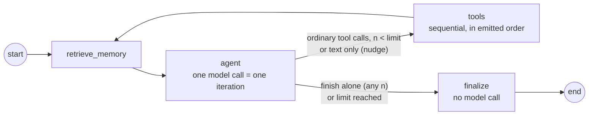

# Architecture

The Coder agent is a hand-built LangGraph `StateGraph`, not the prebuilt ReAct agent. The rubric-critical behaviour stays explicit and testable: memory retrieval before every model call, the iteration counter, sequential tool execution, and a finaliser that builds the validated result without asking the model.

## The graph

| Node | Code | What it does |
|---|---|---|
| `retrieve_memory` | `orchestration/graph.py` | Queries Chroma with the task plus the latest observation, formats the hits and the sliding window into a `# Memory` block, and emits a `memory` event. It runs before **every** `agent` call. |
| `agent` | `orchestration/graph.py` | Sends `SystemMessage(SYSTEM_PROMPT + memory)` plus the run's messages to the model. It increments `iterations`, extracts a numbered plan, and classifies the reply (see routing). |
| `tools` | `orchestration/graph.py`, `tools/dispatch.py` | Answers rejected calls, runs the remaining calls one by one, and appends a `ToolMessage` for each. The first `ToolError` skips the rest of the batch. A non-zero exit code or a timeout is an observation, not an error. |
| `finalize` | `orchestration/finalize.py` | Builds `CoderResult` from state and from the files on disk, then runs delivery verification. It makes no model call. |

The system message is rebuilt for each call and never stored in state. Memory therefore reaches every call, and the stored conversation stays exactly what the model said and observed.

## Routing precedence

`orchestration/routing.py::classify`. *n* is the number of model calls so far, including this one. The top matching rule wins.

1. **`finish` is the only call.** Its arguments are validated, then the run finalizes. This also applies at *n* = limit. Invalid arguments are rejected with an observation and treated as rule 4.
2. **`finish` mixed with other calls.** `finish` is rejected ("finish must be called alone, after your last action") and the other calls fall through to rule 3.
3. **Ordinary calls.** They execute if *n* < limit. At the limit they are **not** executed, because the agent could never see their results. Status becomes `iteration_limit`.
4. **No tool calls.** The agent is nudged to call a tool or finish if *n* < limit; otherwise status becomes `iteration_limit`.

The limit is `CODER_MAX_ITERATIONS` (default and hard cap: 10). `Settings` rejects anything outside 1–10. LangGraph's `recursion_limit` (3 × limit + 5) is only a backstop.

## Tools and the execution record

- **Confinement** (`tools/workspace.py`). Every file-tool path and every execution target is resolved, following `..` and symlinks, and must lie inside `./workspace/`. A leading `workspace/` prefix is stripped, because models often add one.
- **`exec_python`** (`tools/exec_python.py`). It runs `sys.executable -s tools/_runner.py <mode> <target> …` with `cwd=workspace`, `stdin=/dev/null`, and its own process group.
  - On timeout (default 10 s) the **whole process group** is killed with `SIGKILL`, including any children the script spawned.
  - Output is drained by reader threads that keep the first 8,000 bytes per stream. A print flood can't deadlock the run or fill memory or disk.
  - Test files (`test_*.py`, `*_test.py`) run under pytest. Inline code is written to `.coder_snippets/` first, so every executed artifact exists on disk.
- **The runner** (`tools/_runner.py`) runs inside the child process. It installs a `MetaPathFinder` that records the SHA-256 of every workspace module at the moment it is imported, plus the target itself. At exit it writes these to a JSON record.
- **Verification** (`orchestration/verify.py`). A delivered `.py` file is verified only if some successful run after its last write loaded it with the hash it has on disk now. So "wrote A, ran it, overwrote with B, finished" is reported `failed`, and so is a broken module that was never imported by the passing run. `CoderResult`'s model validator then refuses `status="success"` unless the last run passed and delivery is verified.

## Memory

- **Sliding window** (`memory/window.py`). The last N conversation turns, where a turn is a task plus the agent's final explanation (`MEMORY_WINDOW_TURNS`, default 10). It lives in the process. The current run's ReAct messages are never trimmed; the 10-call cap bounds them.
- **Semantic store** (`memory/semantic.py`). A Chroma `PersistentClient` at `./.chroma/`, using cosine distance and Chroma's default local embedding (all-MiniLM-L6-v2 via ONNX, no API key).
  - After each run the agent stores its task, outcome, files, plan, summary, and the names of the top-level functions and classes it delivered.
  - Retrieval returns the top 3 hits with distance ≤ 0.65.
- **Reset** (`CoderAgent.reset_memory`). Under the workspace lock, it clears Chroma, the workspace, and the window, and bumps a generation counter in `.coder/generation`. Every process checks the counter at the start of each run and drops its stale window, so a reset from the CLI also reaches an idle web server.

## Concurrency

There is one active run per workspace across processes, enforced by `filelock` on `.coder/workspace.lock` with a non-blocking acquire. A second run gets "workspace busy": exit code 2 in the CLI, HTTP 409 in the web UI. The web UI's Run button stays disabled while any process holds the lock.

## Streaming

`CoderAgent.stream(task)` yields `StepEvent`s (`start`, `memory`, `thought`, `plan`, `action`, `observation`, `nudge`, `limit`, `error`, `result`). Graph nodes emit them with `get_stream_writer()`, and the agent reads them with `stream_mode=["custom", "values"]`. The CLI renders them with rich. The web server forwards them as server-sent events on `POST /api/run`.

## Extension points for Modules 2–5

- **Module 2 (PM agent).** `agents/pm_agent.py` produces a spec. The PM → Coder handoff is `CoderAgent.run(task)`, and the structured `CoderResult` is the return contract.
- **Module 3 (QA agent).** `CoderResult.files`, `result` and `verification_notes` give QA everything it needs to re-run and critique. A QA loop becomes a second graph that calls the Coder again with feedback.
- **Module 4 (MCP/A2A, Docker).** The tools are plain functions behind `tools/dispatch.py::run_action`, so they can be exposed over MCP unchanged. Real isolation replaces the subprocess with a container per run.
- **Module 5 (observability, cost).** LangSmith tracing already works through environment variables. `StepEvent` is the place to add token and cost accounting.
