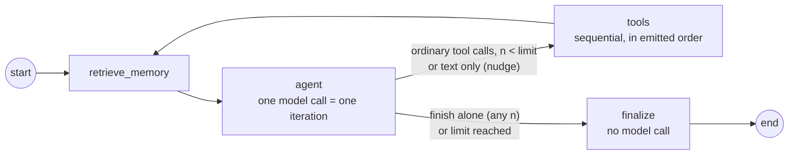

# Architecture

The Coder agent is a hand-built LangGraph `StateGraph`, not the prebuilt ReAct agent. The rubric-critical behaviour stays explicit and testable: memory retrieval before every model call, the iteration counter, sequential tool execution, and a finaliser that builds the validated result without asking the model.

## The graph



| Node | Code | What it does |
|---|---|---|
| `retrieve_memory` | `orchestration/graph.py` | Queries Chroma with the task plus the latest observation, formats the hits and the sliding window into a `# Memory` block, and emits a `memory` event. It runs before **every** `agent` call. |
| `agent` | `orchestration/graph.py` | Sends `SystemMessage(SYSTEM_PROMPT + memory)` plus the run's messages to the model. It increments `iterations`, extracts a numbered plan, and classifies the reply (see routing). |
| `tools` | `orchestration/graph.py`, `tools/dispatch.py` | Answers rejected calls, runs the remaining calls one by one, and appends a `ToolMessage` for each. The first `ToolError` skips the rest of the batch. A non-zero exit code or a timeout is an observation, not an error. |
| `finalize` | `orchestration/finalize.py` | Builds `CoderResult` from state and from the files on disk, then runs delivery verification. It makes no model call. |

The system message is rebuilt for each call and never stored in state. Memory therefore reaches every call, and the stored conversation stays exactly what the model said and observed.

## Routing precedence

`orchestration/routing.py::classify`. *n* is the number of model calls so far, including this one. The top matching rule wins.

1. **`finish` is the only call.** Its arguments are validated, then the run finalizes. This also applies at *n* = limit. Invalid arguments are rejected with an observation and treated as rule 4.
2. **`finish` mixed with other calls.** `finish` is rejected ("finish must be called alone, after your last action") and the other calls fall through to rule 3.
3. **Ordinary calls.** They execute if *n* < limit. At the limit they are **not** executed, because the agent could never see their results. Status becomes `iteration_limit`.
4. **No tool calls.** The agent is nudged to call a tool or finish if *n* < limit; otherwise status becomes `iteration_limit`.

The limit is `CODER_MAX_ITERATIONS` (default and hard cap: 10). `Settings` rejects anything outside 1–10. LangGraph's `recursion_limit` (3 × limit + 5) is only a backstop.

## Tools and the execution record

- **Confinement** (`tools/workspace.py`). Every file-tool path and every execution target is resolved, following `..` and symlinks, and must lie inside `./workspace/`. A leading `workspace/` prefix is stripped, because models often add one.
- **`exec_python`** (`tools/exec_python.py`). It runs `sys.executable -s tools/_runner.py <mode> <target> …` with `cwd=workspace`, `stdin=/dev/null`, and its own process group.
  - When the run ends, the **whole process group** is killed with `SIGKILL`, including any children the script spawned. On timeout (default 10 s) that happens early.
  - Bytecode is cached outside the workspace, and the runner drops the workspace's cached modules before each run. A same-size rewrite within one second can't run stale `.pyc` code.
  - Output is drained by reader threads that keep the first 8,000 bytes per stream. A print flood can't deadlock the run or fill memory or disk.
  - Test files (`test_*.py`, `*_test.py`) run under pytest. Inline code is written to `.coder_snippets/` first, so every executed artifact exists on disk.
- **The runner** (`tools/_runner.py`) runs inside the child process. It installs a `MetaPathFinder` that records the SHA-256 of every workspace module at the moment it is imported, plus the target itself. At exit it also sweeps `sys.modules` for workspace files loaded by other importers, such as `conftest.py` loaded by pytest's assertion rewriter. It writes the result to a JSON record.
- **Files written by executed code.** `.py` files that a run creates or changes, rather than `write_file`, count as writes made at that step. They are reported in the observation, delivered, and need a later successful run to be verified.
- **Verification** (`orchestration/verify.py`). A delivered `.py` file is verified only if some successful run after its last write loaded it with the hash it has on disk now. So "wrote A, ran it, overwrote with B, finished" is reported `failed`, and so is a broken module that was never imported by the passing run. `CoderResult`'s model validator then refuses `status="success"` unless the last run passed and delivery is verified.

## Memory

- **Sliding window** (`memory/window.py`). The last N conversation turns, where a turn is a task plus the agent's final explanation (`MEMORY_WINDOW_TURNS`, default 10). It lives in the process. The current run's ReAct messages are never trimmed; the 10-call cap bounds them.
- **Semantic store** (`memory/semantic.py`). A Chroma `PersistentClient` at `./.chroma/`, using cosine distance and Chroma's default local embedding (all-MiniLM-L6-v2 via ONNX, no API key).
  - After each run the agent stores its task, outcome, files, plan, summary, and the names of the top-level functions and classes it delivered.
  - Retrieval returns the top 3 hits with distance ≤ 0.65.
- **Reset** (`CoderAgent.reset_memory`). Under the workspace lock, it clears Chroma, the workspace, and the window, and bumps a generation counter in `.coder/generation`. Every process checks the counter at the start of each run and drops its stale window, so a reset from the CLI also reaches an idle web server.

## Concurrency

There is one active run per workspace across processes, enforced by `filelock` on `.coder/workspace.lock` with a non-blocking acquire. A second run gets "workspace busy": exit code 2 in the CLI, HTTP 409 in the web UI. The holder also writes its pid to `.coder/running`. The web UI's status poll reads that marker instead of probing the lock, so polling can never make a starting run see "busy". The Run button stays disabled while any live process holds the lock.

## Streaming

`CoderAgent.stream(task)` yields `StepEvent`s (`start`, `memory`, `thought`, `plan`, `action`, `observation`, `nudge`, `limit`, `error`, `result`). Graph nodes emit them with `get_stream_writer()`, and the agent reads them with `stream_mode=["custom", "values"]`. The CLI renders them with rich. The web server forwards them as server-sent events on `POST /api/run`. A dedicated thread drives each run. When the browser disconnects, that thread stops at the next event and closes the run, which releases the lock.

## v2: the PM → Coder team graph

Module 2 wraps the Coder in an outer graph (`orchestration/team_graph.py`, built by `build_team_graph(TeamDeps(pm, coder))`). The inner graph above is untouched and runs inside `coder_node`. The diagram is in the [README](../README.md#v30-pm--coder--qa), and `tests/test_docs.py` checks it against the compiled graph.

| Node | What it does |
|---|---|
| `pm_node` | `PMAgent.draft_spec(requirement)` returns a validated `Spec`. On a `PMError` it records `error` and `status="failed"`. |
| `consolidate_node` | Runs only when the PM returned more than `MAX_TASKS` (8) tasks. Merges them (model first, deterministic fallback) and records a `Consolidation`. |
| `dispatch_node` | Builds a `TaskHandoff` for `tasks[current_task_index]`, sets `handoff`, marks the task `in_progress`. |
| `coder_node` | Reads only `state["handoff"]`, renders it with `render_task`, runs one `CoderAgent` for the whole project, forwards each step event, records the task result. |
| `finalize` | Sets the run status: `completed` (every task `done`), `partial` (some `failed`), `failed` (PM error or no tasks). |

Routers: `route_after_pm` sends an error or an empty task list to `finalize`, more than 8 tasks to `consolidate_node`, otherwise to `dispatch_node`. `route_after_coder` sends the run back to `dispatch_node` while tasks remain, otherwise to `finalize`. A failed task does not stop the run.

### `ProjectState`

Defined in `orchestration/project_state.py`. Fields without a reducer are overwritten by the node that owns them.

| Field | Type | Owner (writes it) | Reducer |
|---|---|---|---|
| `requirement` | `str` | set at entry | none, never modified |
| `spec` | `Spec \| None` | `pm_node` | none (written once) |
| `tasks` | `list[Task]` | `pm_node`; `consolidate_node` replaces it | none (overwrite) |
| `consolidation` | `Consolidation \| None` | `consolidate_node` | none |
| `task_status` | `dict[str, TaskRecord]` | `pm_node` (pending, only when no consolidation follows), `consolidate_node` (pending, for the merged ids `M1…Mk`), `dispatch_node` (`in_progress`), `coder_node` (`done` / `failed`) | `merge_dicts` (later keys win) |
| `current_task_index` | `int` | `coder_node` (+1 per task) | none |
| `handoff` | `TaskHandoff \| None` | `dispatch_node` sets it, `coder_node` clears it | none |
| `artifacts` | `list[TaskArtifact]` | `coder_node` (one `CoderResult` per task) | `operator.add` |
| `code_output` | `dict[str, str]` | `coder_node` (path to content) | `merge_dicts` (later tasks win) |
| `work_in_progress` | `list[str]` | every node (chronological log) | `operator.add` |
| `error` | `str \| None` | `pm_node` | none |
| `status` | `"running" \| "completed" \| "partial" \| "failed"` | `pm_node` on failure, `finalize` | none |

### Handoff protocol

`dispatch_node` is the readiness signal: it writes a `TaskHandoff` into state before the Coder starts, so the handoff is visible in the streamed state. `coder_node` then uses that object and nothing else. It never sees `spec`, `tasks` or `requirement`. `render_task(handoff)` turns it into the Coder's task text: project name and description, "Task T2 (2 of 4, high priority)", the title and description, the acceptance criteria as a checklist, the files earlier tasks produced, and the instruction to build on them, keep earlier tests passing and run all tests before finishing.

Every run writes `handoff-<task_id>.json` into `.coder/runs/<run id>/`. An example of what `handoff-T1.json` looks like (illustrative values; the real file from the demo run will be in `docs/evidence/v2/`):

```json
{
  "task_id": "T1",
  "title": "Create the FastAPI app with GET /health",
  "description": "Create main.py with a FastAPI app and a GET /health endpoint that returns {\"status\": \"ok\"}.",
  "acceptance_criteria": [
    "GET /health returns HTTP 200 with the JSON body {\"status\": \"ok\"}",
    "main.py defines a module-level `app = FastAPI(...)`"
  ],
  "priority": "high",
  "position": 1,
  "total": 2,
  "spec_name": "Echo API",
  "spec_description": "A small REST API with a health check and an echo endpoint.",
  "prior_files": []
}
```

Later tasks get `prior_files` filled from the keys of `code_output` (for T2: `["main.py", "test_main.py"]`, say).

Locking and limits: `TeamRunner` holds the workspace lock for the whole project run, so no other `coder` or `team` run can interleave between tasks. Each task keeps v1's limits: at most 10 Coder iterations and a 10 s exec timeout.

## v3: the PM → Coder ↔ QA team graph

Module 3 adds a QA agent and a reflection step to the outer graph. The inner graph and the `coder` and `coder-web` commands are unchanged. The diagram is in the [README](../README.md#v30-pm--coder--qa) and is checked against the compiled graph by `tests/test_docs.py`. `build_team_graph(TeamDeps(pm, coder, qa))` takes the QA agent as a third dependency.

Per task, a **round** is one QA test run (1 to `QA_MAX_ITERATIONS`, default and maximum 5):

1. `dispatch_node` hands the task over.
2. `coder_node` delivers.
3. `reflect_node` has the Coder critique its code and revise it, then sends `review_request` for round 1 with the post-revision file hashes.
4. `qa_node` receives and validates the request, runs QA's review and replies, echoing the `correlation_id`.
5. `coder_node` receives the reply. `approved` closes the task as `done`, `final_report` closes it as `failed`, and `fix_instruction` triggers a revision run and a `review_request` for the next round.

Reflection runs once per task, before the first QA round. The Coder leaves a task only on an explicit `approved` or `final_report`.

### Node responsibilities

| Node | What it does |
|---|---|
| `pm_node`, `consolidate_node`, `dispatch_node` | As in v2. `dispatch_node` also resets `qa_round`, `task_files`, `qa_suite` and `reflection_ok`, and the handoff now stays set until the task closes. |
| `coder_node` | Three steps, kept in `coder_step`. **deliver** (`qa_round == 0`): runs the Coder on the task text. **revise**: receives a `fix_instruction`, runs the Coder on it, re-hashes every delivered file and sends `review_request` for the next round. **close**: receives `approved` or `final_report`, records status and outcome, stores the approved suite, advances `current_task_index` and clears the handoff. |
| `reflect_node` | Critique (`CoderAgent.critique`), then a Coder revision run on it. The revision must change a file; if the critique fails to parse or no file changed, the pair is retried once. If it still fails, `Reflection.error` is set, QA runs one diagnostic round and replies `final_report(reason="no_revision")`. |
| `qa_node` | Receives the request, calls `QAAgent.review(...)`, emits the `qa_report`, and replies by `_reply`. |
| `finalize` | Sets the run status. Before that, it runs the project regression check: every `done` task's canonical suite is restored and run once against the final workspace. A task whose suite fails, errors, skips or is missing tests becomes `failed` with `qa_outcome="regressed"`. The result is stored as `state["regression"]`. |

`_reply` decides QA's answer, in this order: `final_report(no_revision)` if reflection recorded no revision; `approved` if the report is approved; `final_report(qa_error)` if QA itself failed (including any exception QA raises, which `qa_node` turns into a `qa_error` report); `final_report(max_iterations)` at the round limit; otherwise `fix_instruction`.

Routers: `route_after_pm` is as in v2. `route_after_coder` returns `reflect_node` after the first delivery, `qa_node` after a revision, `dispatch_node` when a task has closed and tasks remain, and `finalize` when none remain. The recursion limit is `MAX_TASKS * (2 * qa_max_iterations + 3) + 10`.

### A2A messages (`orchestration/a2a.py`)

A `Message` is frozen and has five fields: `sender`, `receiver`, `intent`, `payload`, `correlation_id` (default `uuid4().hex`). The agents are exactly `coder` and `qa`.

| Intent | Direction | Payload model | Fields |
|---|---|---|---|
| `review_request` | coder → qa | `ReviewRequest` | `task_id`, `round` (≥ 1), `files` (path → sha256) |
| `fix_instruction` | qa → coder | `FixInstruction` | `task_id`, `round`, `issues` (≥ 1 `Issue`), `summary` |
| `approved` | qa → coder | `Approved` | `task_id`, `round`, `tests_run` (≥ 1), `test_file` |
| `final_report` | qa → coder | `FinalReport` | `task_id`, `round`, `reason` (`max_iterations`, `qa_error` or `no_revision`), `unresolved`, `summary` |

Validation happens twice:

- **At construction.** Both agents must be known and different, the intent must exist, and the payload must validate against that intent's model (all payload models forbid extra fields). A bad message raises `ValueError`.
- **At receipt, the trust boundary.** `Endpoint.receive` pops messages in order and discards, with a logged `rejected` event, any whose `(sender, intent)` is not in the agent's accept set (`QA_ACCEPTS`, `CODER_ACCEPTS`), whose `task_id` is not the current task, or (Coder only) whose `correlation_id` is not the outstanding request's. An empty queue raises `A2AError`, a protocol bug that propagates.

The `Broker` is synchronous: one `collections.deque` per agent, `send`, `receive`, `reject`, and an `on_event` callback for every `sent`, `received` and `rejected` record. LangGraph runs these nodes one at a time, so an `asyncio` queue would add an event loop for no concurrency, while keeping the property that matters: agents hold only the broker, never each other.

### QA agent (`agents/qa_agent.py`)

- **Freshness.** Each requested file's on-disk hash is compared with the request. A mismatch is a High issue.
- **Suite.** On round 1, the suite is generated from the task's numbered criteria (with one retry on an invalid suite). The canonical copy is stored at `<state dir>/qa/suites/test_qa_<id>.py`, outside the Coder's workspace.
- **Restore and run.** Before every run, QA writes this task's suite and every earlier approved task's, from the suites held in graph state, into the workspace root and over their canonical files. It then runs all of them in one pytest subprocess with a timeout and JUnit output (under the state dir, outside the workspace). `tampered` records a missing or edited workspace copy or canonical file, since code the Coder runs could rewrite either. A collection error in one suite does not stop the others (`--continue-on-collection-errors`).
- **QA's pytest config.** QA passes `-c <state dir>/qa/pytest.ini`, an empty ini of its own, with `--rootdir` set to the workspace, so the Coder's `pytest.ini` or `pyproject.toml` `addopts` cannot deselect or reshape QA's tests. The Coder's `conftest.py` is still loaded.
- **Reconcile.** JUnit results are matched to each suite's manifest. A failed, errored or skipped test, a missing test, a timeout and unparsable output are each a High issue. A timeout or unreadable JUnit XML is one High issue, without a "did not run" issue per test; the tests are still listed as `missing`, so approval stays blocked. Exit code 0 alone never approves.
- **Fix plan.** One model call turns failures into `{test, root_cause, fix}` entries merged into the issues.
- **Approval** is computed in code: every manifest test of every suite run ran and passed, the exit code is 0, nothing timed out and there is no High issue. A model can never approve.

### New `ProjectState` keys

| Field | Meaning | Reducer |
|---|---|---|
| `qa_round` | QA rounds completed for the current task | none |
| `outstanding_request` | `correlation_id` of the pending `review_request` | none |
| `task_files` | every file this task's Coder runs wrote, re-hashed from disk before each request | none (the node merges) |
| `qa_suite` | the current task's suite | none |
| `approved_suites` | canonical suites of approved tasks (restored each round and in the regression check) | `merge_dicts` |
| `regression` | the `finalize` regression result | none |
| `reflection_ok` | the current task's reflection recorded a revision | none |
| `coder_step` | `deliver`, `revise`, `close` or `None` | none |
| `qa_reports`, `reflections` | per-round `QAReport`s and the `Reflection`s | `operator.add` |

`TaskRecord` gains `qa_rounds`, `qa_outcome` (`approved`, `unresolved`, `qa_error`, `no_revision`, `regressed`), `unresolved`, `reflected` and `qa_test_file`. A task is `done` only when QA approved it, reflection recorded a revision (`coder_node` checks this again on `approved`), and the regression check still passes.

### Evidence files

Each run directory adds `reflection-<task>.json`, `qa-<task>-r<n>.json`, `qa-tests-<task>.py`, `a2a-log.jsonl` (two capability lines, then every `sent`, `received` and `rejected` event) and `regression.json` (when at least one task is done). `state-after-<task>.json` is now written when the task closes.

A task's `state-after-<id>.json` and its transcript `task_done` line show the status at the moment the task closed. The regression check in `finalize` can later change a `done` task to `failed` (outcome `regressed`). The summary table, `regression.json` and `final-state.json` hold the final status.

## Extension points for Modules 2–5

- **Module 2 (PM agent), built.** `agents/pm_agent.py` produces a spec; the outer graph (see above) hands each task to the Coder as a `TaskHandoff`, and the structured `CoderResult` is the return contract.
- **Module 3 (QA agent), built.** `agents/qa_agent.py` and the Coder ↔ QA loop in the outer graph (see the v3 section above).
- **Module 4 (MCP, Docker).** The tools are plain functions behind `tools/dispatch.py::run_action`, so they can be exposed over MCP unchanged. Real isolation replaces the subprocess with a container per run.
- **Module 5 (observability, cost).** LangSmith tracing already works through environment variables. `StepEvent` is the place to add token and cost accounting.
