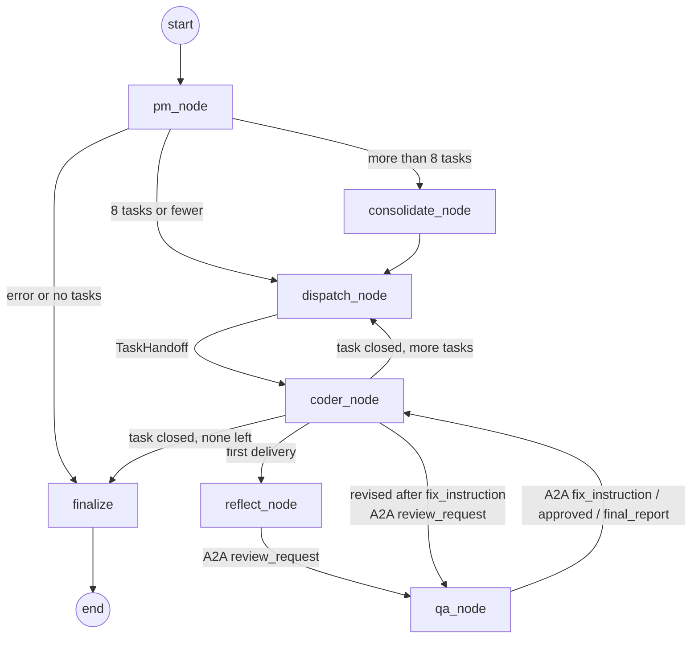

# Multi-Agent System v3.0 (PM → Coder ↔ QA over A2A): Design

Status: draft for Brandon's review, 2026-11-02.
Builds on: v2 (`docs/superpowers/specs/2026-10-29-pm-coder-v2-design.md`), merged to `main` at `4b6f8ba`.
Course sources: Module 3 Project Guide, the Module 3 submission rubric (C3.1–C3.6), and the Section 2/3 notes. They're summarized in `../multi-agent-module-3-notes/MODULE-3-NOTES.md` (outside this repo).

## 1. Intent

Complete the three-agent team.
- A **QA & Debugger agent** writes real pytest tests from each task's acceptance criteria, runs them in the sandbox, and turns failures into structured fix instructions.
- The Coder **critiques and revises its own code once** before QA sees it, then **revises from QA's fixes** until QA's tests pass or a configurable round limit is reached.
- Coder and QA talk **only through A2A messages** on an in-process broker, and every message is logged.

The point: a grader reading the run directory can see each claim (tests written, tests run, failure → fix → retest, honest stop) without trusting the model's own account.

## 2. Source requirements

### Project guide, Module 3 instructions (numbered as in the guide)
15. QA & Debugger agent: receives code from the Coder, writes automated pytest tests for the acceptance criteria, executes them, parses failures, produces a structured fix-instruction list.
16. Loop: Coder → QA → (fixes) → Coder → QA re-test. It ends when all tests pass or after at most 5 iterations.
17. Self-reflection inside the Coder after generation and before QA: a self-critique (potential bugs, edge cases), then a revision based on it.
18. A2A (our chosen route): A2A-compliant Coder ↔ QA messages with correlation ids and intent validation.
19. Convergence safeguard: after 5 iterations without passing, QA produces a final report of unresolved issues.
20. Tests: QA with mocked code input produces a correctly shaped issue list; the loop ends correctly on success and at max iterations.
21. README: which protocol and why, plus a diagram with all three agents.

Technical requirements:
- Real pytest, sandboxed (subprocess with a timeout).
- Reflection runs at least once and produces revised output.
- A2A messages carry `sender, receiver, intent, payload, correlation_id`.
- Max iterations come from an env var, default 5.

Grading demo: "Implement a Python module that contains a linked list class with insert, delete, search, and reverse methods. All methods must be covered by tests."

### Rubric details that shape the design
- **C3.1**: tests assert behavior, run in a subprocess with a timeout, and issues are linked to failing assertions. An LLM-only review is Not Yet.
- **C3.2**: a *controlled failing case* must show QA feedback driving a Coder revision. QA must not retest stale output. Evidence must link failing assertion → fix instruction → revised code → retest for one task.
- **C3.3**: the limit comes from an env var (default 5). Both a success exit and a *forced* non-converging exit must be observed. At the limit there's a final unresolved-issue report and no success claim.
- **C3.4**: critique → revised code, the revised artifact is what QA gets, and the order shows reflection before QA. A critique that is only logged is Not Yet.
- **C3.5 (5 of 10 points)**: A2A messages with all five fields plus intent validation, with logs from the grading run showing real use.
- **C3.6**: required tests pass; the linked-list demo passes generated behavioral tests for all four methods; the README has the three-agent diagram and the protocol rationale.

## 3. Goals, non-goals, anti-goals

**Goals.** Rubric C3.1–C3.6 met with file-based evidence. The v2 behaviours keep working: PM spec, consolidation, handoff, per-task records, the `--demo api` fixture.

**Non-goals.**
- MCP: the rubric grades one route.
- The three-agent debate (Lab 3.4 "recommended").
- Network A2A (HTTP, agent cards, discovery).
- Parallel tasks.
- Changes to the v1 inner graph, `coder`, and `coder-web`.

**Anti-goals.**
- QA "approving" on LLM opinion.
- Success claimed while any QA test fails.
- A Coder that can pass by editing QA's tests.
- A2A that is only named in the README.
- An unbounded loop.

## 4. Architecture

Per task, round `r` = one QA test run (1 ≤ r ≤ `QA_MAX_ITERATIONS`):
1. `dispatch_node` hands the task over (v2).
2. `coder_node` (deliver) runs the Coder on the task text, as in v2.
3. `reflect_node` runs the Coder's critique, then a Coder revision run on the critique. It sends `review_request` (round 1) with the post-revision file hashes.
4. `qa_node` receives and validates the request, then runs QA's review:
   - generates the task's suite on round 1 and stores the canonical copy outside the workspace;
   - restores into the workspace the canonical suites of this task **and every earlier approved task**, then runs them all in one pytest invocation in the sandbox (a cumulative regression run);
   - turns the results into a `QAReport`.

   It replies, echoing the `correlation_id`:
   - `final_report(reason="no_revision")` if reflection produced no revised artifact (§8);
   - otherwise `approved` if the report is approved (§6: every expected test in every suite ran and passed);
   - otherwise `final_report` if `r == QA_MAX_ITERATIONS` or QA itself failed;
   - otherwise `fix_instruction`.
5. `coder_node` receives and validates the reply.
   - `approved` → task `done`.
   - `final_report` → task `failed` with the unresolved issues listed.
   - `fix_instruction` → a Coder revision run on the fixes, then `review_request` for round `r+1` → step 4.

The Coder exits a task **only on an explicit `approved` or `final_report` intent** (course rule). Reflection runs once per task, before the first QA round. Fix rounds go straight to QA.

**Project regression check.** `finalize` restores the canonical suite of every `done` task and runs them all once more against the final workspace. Any task whose suite now fails, errors, skips or is missing tests becomes `failed` with `qa_outcome="regressed"`, so the run is `partial`. The result is stored as `state["regression"]` and written to `regression.json`. This catches a later task breaking an earlier one when the later task itself ended without approval.

## 5. A2A protocol (`orchestration/a2a.py`)

**Message** (Pydantic, frozen, `extra="forbid"`): `sender: str`, `receiver: str`, `intent: str`, `payload: dict`, `correlation_id: str` (default `uuid4().hex`).

**Construction-time validation** (raises `ValueError`):
- `sender` and `receiver` are in `AGENTS = {"coder", "qa"}` and differ;
- `intent` is in `INTENTS`;
- `payload` validates against that intent's payload model.

| Intent | Normal direction | Payload model | Fields |
|---|---|---|---|
| `review_request` | coder → qa | `ReviewRequest` | `task_id`, `round` (≥1), `files: dict[path, sha256]` |
| `fix_instruction` | qa → coder | `FixInstruction` | `task_id`, `round`, `issues: list[Issue]` (≥1), `summary` |
| `approved` | qa → coder | `Approved` | `task_id`, `round`, `tests_run` (≥1), `test_file` |
| `final_report` | qa → coder | `FinalReport` | `task_id`, `round`, `reason: "max_iterations" \| "qa_error" \| "no_revision"`, `unresolved: list[Issue]`, `summary` |

**Receive-time validation, the trust boundary.** Each agent declares what it accepts. These are the capability advertisements, logged at run start:
- `QA_ACCEPTS = {("coder", "review_request")}`
- `CODER_ACCEPTS = {("qa", "fix_instruction"), ("qa", "approved"), ("qa", "final_report")}`

`Endpoint.receive(...)` pulls messages from its queue in order and **logs and discards** any message whose `(sender, intent)` isn't accepted, whose `payload.task_id` isn't the current task, or (Coder only) whose `correlation_id` isn't the outstanding request's. It returns the first acceptable message. If the queue runs dry first, it raises `A2AError`. Both ends are ours, so that's a bug and it propagates.

**Broker.** One FIFO queue per agent, and agents hold only the broker. `send(msg)` appends to `msg.receiver`'s queue. `receive(agent)` pops, or raises `A2AError` when empty. Every send, receive and rejection is reported to `on_event(record)`, where `record = {"event": "sent"|"received"|"rejected", "message": {...5 fields...}, "reason": str|None, "at": iso8601}`.

Design ruling: the course's Broker uses `asyncio.Queue` because its agents are concurrent coroutines. Our LangGraph nodes run sequentially and synchronously, so the broker is a synchronous `collections.deque` per agent with the same send/receive contract. The decoupling the course cares about (no agent holds a reference to another, all traffic goes through the broker) is kept.

## 6. Review models (`orchestration/review.py`)

- `Issue`: `severity: "High"|"Medium"|"Low"`, `test: str | None` (pytest node name), `criterion: str | None` (the task criterion the test covers), `location: str` (`file.py:line` or the test name), `assertion: str` (failure message, ≤ 500 chars), `fix: str`.
- `TestOutcome`: `name`, `outcome: "passed"|"failed"|"error"|"skipped"`, `message: str`.
- `QATestSuite` (QA's LLM output): `content: str` (the test module source), `tests: list[SuiteTest]` (`name`, `criterion: int`, 1-based into the task's criteria).
  - Valid when `content` parses;
  - every `tests[].name` is a top-level `def test_*` in it;
  - names are unique;
  - every criterion index 1..n appears at least once.
- `QAReport`: `task_id`, `round`, `test_file`, `suite_sha`, `suites_run: dict[task_id, suite_sha]` (this task's plus earlier approved tasks'), `tested_files: dict[path, sha256]`, `tests_run`, `passed`, `failed`, `errors`, `skipped`, `missing: list[str]` (manifest tests with no passing-or-failing result), `exit_code: int | None`, `timed_out`, `duration_s`, `results: list[TestOutcome]`, `issues: list[Issue]`, `tampered: bool`, `qa_error: str | None`, `approved: bool`.
  - Validator: `approved` requires `tests_run ≥ 1`, `passed == tests_run`, `failed == errors == skipped == 0`, `missing == []`, `exit_code == 0`, `not timed_out`, `qa_error is None`, and no High issue.
  - **Reconciliation with the manifest.** Every `SuiteTest` of every suite run must appear in `results` as `passed`; since every criterion maps to at least one manifest test, this means every criterion is covered by a passing test. A skipped manifest test, an absent one (`missing`), or an unexpected extra result is a High issue. pytest's exit code 0 alone never approves (it is 0 for an all-skipped run).
  - Any High issue forces `approved` to be False.
  - A violating model **raises**, because approval is computed in code and never taken from an LLM.
- `CritiqueItem`: `kind: "bug"|"edge_case"`, `location`, `concern`, `change`. `Critique`: `items` (1–8).
- `Reflection`: `task_id`, `critique: Critique | None`, `before`/`after: dict[path, sha256]`, `changed: list[str]`, `revision_status: Status | None`, `error: str | None`.

## 7. QA agent (`agents/qa_agent.py`)

`QAAgent(settings, *, model=None)`. Same lazy `make_model` and `with_structured_output(..., include_raw=True)` pattern as `PMAgent`.

`review(handoff, request: ReviewRequest, round: int, suite: QATestSuite | None, prior: dict[str, QATestSuite]) -> tuple[QAReport, QATestSuite | None]` (`prior` = the canonical suites of earlier approved tasks):
1. **Freshness.** For each requested file, compare its on-disk sha with the request. A mismatch is a High issue ("changed after review request"). The report's `tested_files` are the on-disk hashes actually tested.
2. **Suite.** If `suite` is None (round 1), generate it with `QA_TESTS_PROMPT`. The prompt gets the task's title, description and numbered criteria plus the requested files' contents (names and signatures only; tests come from the criteria).
   - On an invalid suite, retry once with the error appended.
   - A second failure, or any model error, gives a report with `qa_error` set (no tests run).
3. **Canonical suites and restore.** The canonical copy of each suite lives at `settings.state_dir / "qa" / "suites" / test_qa_<id>.py`, outside the Coder's workspace; QA writes it once, on round 1. Before every run, QA writes the canonical content of this task's suite and every `prior` suite to `test_qa_<id lower>.py` at the workspace root. `tampered` is True when any of those workspace files was missing or differed from its canonical copy. QA owns these files.
4. **Run.** One `exec_python(mode="pytest", timeout=settings.exec_timeout_s, junit_xml=…)` over all restored suite files. The JUnit XML goes under `settings.state_dir / "qa"`, outside the workspace.
5. **Parse and reconcile.** `parse_junit` gives counts and `results`, reconciled against the manifests of all suites run (§6).
   - Timeout: one High issue "QA test run timed out after N s".
   - Missing or unparsable XML, or a nonzero exit with no failing case to explain it: a High issue with the stderr tail.
   - Each failed, error or skipped case, and each manifest test with no result, is a High issue. Its `criterion` comes from its suite's map. Its `location` is the last `name.py:line` in the failure text that isn't a `test_*` file, else the test name. An issue from an earlier task's suite is prefixed `regression in <task_id>:`.
6. **Fixes.** When there are issues, one `QA_FIX_PROMPT` call (code plus failures) gives `FixPlan.fixes[{test, root_cause, fix}]`. These are merged by test name. Missing entries or a failed call fall back to `"Make <test> pass: <assertion>"`.
7. **Approve.** Compute `approved` in code (§6).

## 8. Coder self-reflection

- `CoderAgent.critique(task_text: str, files: dict[str, str]) -> Critique`: one structured call on the unbound model with `CRITIQUE_PROMPT`, asking for likely bugs and unhandled edge cases, each with a concrete change. Retry once on parse failure; then raise `ReflectionError`.
- `reflect_node`:
  1. Hash the task's files (*before*).
  2. Run the critique.
  3. Run the Coder on `render_revision(handoff, critique)` ("address each item with a code change or a new test; keep tests passing").
  4. Hash again (*after*) and record a `Reflection`.
  5. Send `review_request` round 1 with the *after* hashes.
- **A revision is required (C3.4).** Reflection succeeds only when the critique parsed *and* `changed` is non-empty. On a critique failure, or a revision run that changed no file, `reflect_node` retries the whole critique → revision once (the retry prompt says the previous attempt produced no change). If it still fails, `Reflection.error` is set, QA still runs one diagnostic round so the evidence shows the code's state, and QA replies `final_report(reason="no_revision")` with that round's issues. The task is `failed` with `qa_outcome="no_revision"`; it can never be `done` without a recorded revision.
- Reflection runs on the first delivery only.

## 9. Limits and termination

- `Settings.qa_max_iterations`: env `QA_MAX_ITERATIONS`, default 5, range 1–5 (the course caps the loop at five). CLI flag `--qa-max-iterations`. A bad value (`0`, `6`, `abc`), from either the env var or the flag, exits 2 with "invalid setting".
- **A task is `done` only when QA approved it and the project regression check (§4) still passes.** The Coder's own status no longer decides. At the limit, on a QA error, without a revision, or on a regression, it's `failed`. The final report's unresolved issues go into `TaskRecord.unresolved`. Run status follows v2: all done → `completed`, otherwise `partial`.
- `recursion_limit = MAX_TASKS * (2 * qa_max_iterations + 3) + 10`.

## 10. State changes (`orchestration/project_state.py`)

New `ProjectState` keys:
- `qa_round: int`: QA rounds completed for the current task.
- `outstanding_request: str | None`: correlation id.
- `task_files: dict[str, str]`: every file this task's Coder runs have written. `CoderResult.files` holds only the files written *in that run*, so the node **accumulates**: each run's files are merged over the existing map (the key has no reducer; the node returns the merged dict), and dispatch resets it. Before every `review_request`, each path is read back from disk and hashed; a path no longer on disk is dropped from `task_files` and from the request, and the drop is logged in the `a2a`/reflection evidence. A revision that touches one of several files therefore still sends every delivered file, the untouched ones with unchanged hashes.
- `qa_suite: QATestSuite | None`
- `approved_suites: dict[str, QATestSuite]` (`merge_dicts`): canonical suites of approved tasks, passed to QA as `prior` and used by the regression check.
- `regression: dict | None`: the `finalize` regression result.
- `reflection_ok: bool`: the current task's reflection recorded a revision (§8); reset by dispatch.
- `coder_step: "deliver" | "revise" | "close" | None`
- `qa_reports: Annotated[list[QAReport], add]`
- `reflections: Annotated[list[Reflection], add]`

The handoff now stays set until the task closes.

New `TaskRecord` fields:
- `qa_rounds: int = 0`
- `qa_outcome: "approved" | "unresolved" | "qa_error" | "no_revision" | "regressed" | None`
- `unresolved: list[str] = []`
- `reflected: bool = False`
- `qa_test_file: str | None`

`iterations` becomes the total Coder turns across all of the task's runs.

## 11. Runner, evidence, CLI

- **`TeamRunner(settings, *, pm=None, coder=None, qa=None)`** builds a fresh `Broker` per run. It writes the two capability lines first, then appends every `a2a` event to `a2a-log.jsonl`. New evidence files:
  - `reflection-<task>.json`
  - `qa-<task>-r<n>.json`
  - `qa-tests-<task>.py` (copy of the canonical suite)
  - `regression.json` (the `finalize` regression run)
  - `state-after-<task>.json`, now written when the task *closes*
- New optional `demo_check(workspace, state) -> (passed, report)`, written to `demo-check.txt`.
- **`TeamEvent` kinds** add `reflection`, `qa_report`, `a2a`.
- **Renderers:** one-line A2A messages (`A2A coder → qa review_request #<cid8> round 1 · 2 files`), the reflection summary, the QA round summary, and two new summary-table columns (`qa rounds`, `qa`).
- **`team --demo linked-list`** runs the grading requirement verbatim, then `check_linked_list`:
  - every task approved with tests run;
  - the canonical QA suites (not the workspace copies) call `insert`, `delete`, `search` and `reverse`;
  - the project regression check passed: every approved task's canonical suite was restored and all its manifest tests passed, with none skipped or missing.

  Exit 0 only if the run completed and the check passed.

## 12. Controlled scenarios (C3.2, C3.3 evidence)

`tests/scenarios.py` builds runners with scripted PM, Coder and QA models, while **pytest runs for real**:
- **feedback**: round 1 ships a linked list whose `reverse` is wrong; QA's test fails; the `fix_instruction` text reaches the Coder's next prompt; round 2 fixes it; QA approves.
- **nonconverging**: the Coder never fixes `reverse`; `QA_MAX_ITERATIONS=2`; `final_report`; task `failed`; run `partial`; exit 1.

`scripts/controlled_runs.py` runs both through `team_cli.main(..., runner=...)` and saves transcripts and run directories to `docs/evidence/v3/controlled/<scenario>/`. Both are labelled "scripted models, real pytest execution". The same scenarios are unit tests.

## 13. Tests

New:
- `test_review_models.py`, `test_a2a.py`, `test_junit.py`
- `test_qa_agent.py`, including the required **mocked-code schema** test; all-skipped and partially skipped suites are not approved; a manifest test with no result is not approved; an earlier task's restored suite runs and its failure is a regression issue; a deleted or edited earlier suite is restored and flagged `tampered`
- `test_reflection.py`
- `test_team_loop.py`: success exit, feedback, max iterations, trust boundary, correlation mismatch, critique failure and no-op revision (`no_revision`, task never `done`), a later task breaking an earlier one, a revision changing one of two files
- the `exec_python` JUnit option
- the linked-list demo check
- the CLI flag and env var
- live `test_demo_linked_list_end_to_end`

Existing team tests move to shared fakes that script the reflection and QA steps. Their v2 assertions stay wherever they still hold.

## 14. Documentation

README:
- the v3 diagram (the docs test keeps it equal to the real graph);
- "Why A2A";
- the env var table (`QA_MAX_ITERATIONS`);
- the evidence index.

`docs/architecture.md` gets a v3 section and `docs/usage.md` the new flags.

## 15. Rubric → evidence

| Criterion | Evidence |
|---|---|
| C3.1 | `agents/qa_agent.py`; `qa-tests-<task>.py`; `qa-<task>-r<n>.json` (results, issues tied to tests); the subprocess and timeout in `tools/exec_python.py` |
| C3.2 | `docs/evidence/v3/controlled/feedback/`: `qa-T1-r1.json` failing assertion → `a2a-log.jsonl` `fix_instruction` → revised file hashes in `review_request` round 2 → `qa-T1-r2.json` passing |
| C3.3 | `QA_MAX_ITERATIONS` in `agents/config.py`; `controlled/nonconverging/` `final_report` and a failed task; the success exit in the linked-list run |
| C3.4 | `reflection-<task>.json` (critique, before and after hashes, changed files); event order in the transcript; `review_request` round 1 hashes = `after` |
| C3.5 | `orchestration/a2a.py`; `a2a-log.jsonl` of the graded run (five fields, `correlation_id` pairs, capability lines); trust-boundary tests |
| C3.6 | test suite; `docs/evidence/v3/linked-list/` (`demo-check.txt`); README |

## 16. Decisions made without Brandon's input

1. A2A over MCP. The A2A exchange *is* the graded loop. MCP would reroute every Coder file tool and touch `verify_delivery`.
2. The broker is synchronous, not `asyncio` (§5).
3. QA writes its suite once per task, keeps the canonical copy outside the workspace, and restores it (plus every earlier approved task's suite) before each run, so the goalposts stay fixed, the Coder can't edit its way to a pass, and a later task can't silently break an earlier one.
4. Reflection runs on the first delivery only. Fix rounds go straight to QA.
5. "Iteration" means one QA test run. Five rounds means up to four Coder fix runs.
6. A QA test-generation failure ends the task immediately with `final_report(reason="qa_error")`, because more Coder rounds can't fix QA's problem.
7. The task outcome is decided by QA's tests, not by the Coder's self-verification.
8. Controlled C3.2 and C3.3 evidence uses scripted models with real pytest. The live demo shows the success path.

## 17. Open questions

- Which repo to submit: the course asks for "the URL of your forked repository". Waiting on Anshuman (carried over from v2).
- Should the live evidence also include a forced non-converging *live* run (`QA_MAX_ITERATIONS=1` on a deliberately contradictory requirement)? It's not planned by default.

## 18. Left to the builder

- Prompt wording within the stated rules.
- Rich styling.
- Truncation lengths below the stated caps.
- How `check_linked_list` finds method calls (AST attribute calls are suggested).
